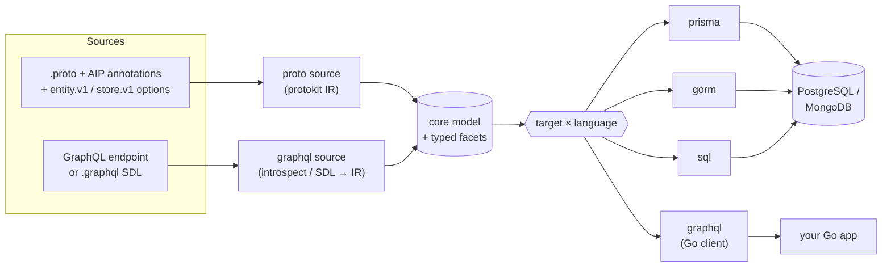
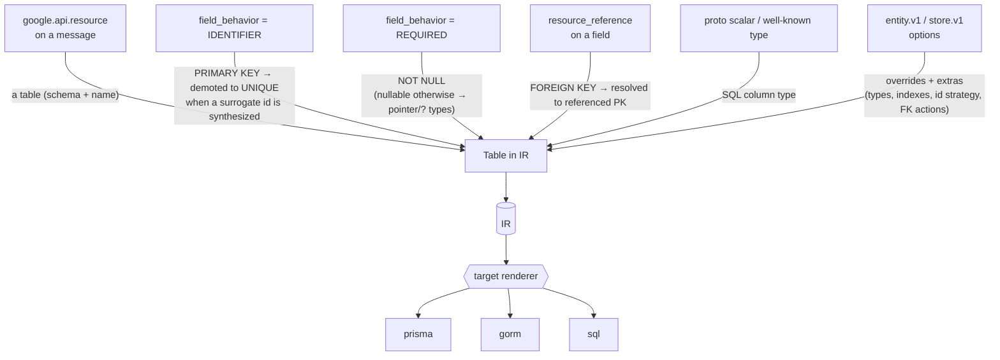
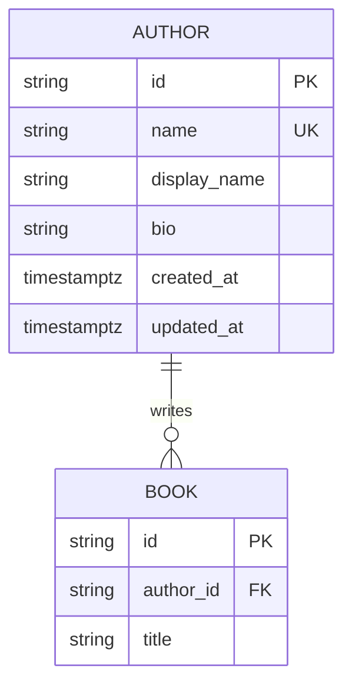
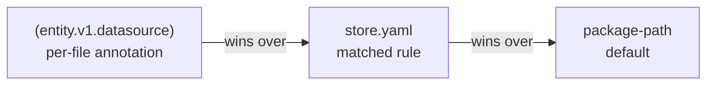

# store

> **One contract, many targets.** `protoc-gen-store` is a co-generation factory:
> feed it **Protobuf** (annotated with [Google AIP](https://google.aip.dev/)) and it
> emits production-grade **Prisma, GORM, and PostgreSQL** schemas; feed it a
> **GraphQL** endpoint or `.graphql` SDL and it emits a typed **Go client**. One
> binary, one `store.yaml`, outputs that always agree.

[](https://github.com/the-protobuf-project/store/releases)
[](https://pkg.go.dev/github.com/the-protobuf-project/store)
[](go.mod)
[](https://buf.build/the-protobuf-project/store)
[](https://github.com/the-protobuf-project/store/actions/workflows/test.yaml)
[](LICENSE)

## Contents

- [Overview](#overview)
- [Features](#features)
- [Architecture](#architecture)
- [How it works](#how-it-works)
- [Install](#install)
- [Quick start](#quick-start)
- [Output layout](#output-layout)
- [GraphQL client SDK](#graphql-client-sdk)
- [Projections and search](#projections-and-search)
- [Time series in Rust (`lang=rust target=influxdb`)](#time-series-in-rust-langrust-targetinfluxdb)
- [Reference integrity](#reference-integrity)
- [Annotations reference](#annotations-reference)
- [Configuration — `store.yaml`](#configuration--ormyaml)
- [Plugin options](#plugin-options)
- [Defaults applied automatically](#defaults-applied-automatically)
- [Determinism & migrations](#determinism--migrations)
- [Versioned migrations (`migrate`)](#versioned-migrations-migrate)
- [Type mapping](#type-mapping)
- [Examples](#examples)
- [Building from source](#building-from-source)
- [Releases & versioning](#releases--versioning)
- [License](#license)

## Overview

**store** is a single binary, `protoc-gen-store`, built as a **co-generation factory** —
a `source → target × language` pipeline. A *source* turns a contract into a neutral
model; a *target* renders that model into code. Two sources ship today:

- **proto** — a [protoc](https://protobuf.dev/) plugin. Annotate messages with the
  [Google AIP](https://google.aip.dev/) standards you already use
  (`google.api.resource`, `field_behavior`, `resource_reference`) and store infers
  tables, columns, primary keys, foreign keys, and relations.
- **graphql** — point it at a live GraphQL endpoint (or a cached `.graphql` SDL file)
  and it introspects the schema.

Both run through the same binary on `buf generate`, selected per output by a
`target=` plugin entry; everything else lives in one [`store.yaml`](#configuration--ormyaml).

| Source | Target | Output |
| --- | --- | --- |
| proto | **prisma** | A complete, runnable Prisma 7 project — multi-file schema, `package.json`, `tsconfig.json`, config, and a `.env.example` to copy to `.env`. |
| proto | **gorm** | Go structs with GORM tags + a migration registry; optional [CRUD stores + first-party telemetry](#gorm-stores-and-tracing), [AIP-160 filter / AIP-132 order_by list engines for **SQL and Hasura GraphQL**](#aip-160-filters-and-list-engines-sql--hasura), and [proto ↔ model converters](#proto--model-converters). |
| proto | **sql** | PostgreSQL DDL — per-schema reference files **and** one transactional, **idempotent** `migrate.sql`; FK constraints, indexes, `updated_at` triggers, `COMMENT ON`. |
| proto | **influxdb** (Rust) | A Rust [time-series client](#time-series-in-rust-langrust-targetinfluxdb) laid out like gorm's output: per database a module that selects the **InfluxDB 3** database or **Arrow IPC** captures, per `time_series` message a model and a typed store (writes, tag filters, windows, latest, aggregates). |
| graphql | **graphql** | A typed Go GraphQL client — row models, a fluent predicate DSL, CRUD/subscription methods (see [GraphQL client SDK](#graphql-client-sdk)). |

Each database target also emits a `README.md` with a Mermaid ER diagram and a
per-model column reference, so the generated tree is self-documenting. Postgres and
MongoDB providers are both supported, and the GraphQL client speaks the
Hasura/DDN/Grafbase lineage through a pluggable [dialect](#dialects). Code emitters
are organized per language (Go today), so a target can grow Python/TypeScript/… output
by adding a template set beside the shared, language-agnostic parsing.

## Features

- **A co-generation factory.** One `source → target × language` pipeline. Sources
  (proto, GraphQL) turn a contract into a neutral model; targets render it. Adding a
  target or a source is a self-contained addition — the shared parsing, config, and
  emit machinery are reused. The proto IR engine
  ([protokit](https://github.com/the-protobuf-project/protokit)) is itself generic, so
  a sibling plugin ([web3](https://github.com/the-protobuf-project/web3)) renders a
  blockchain backend from the same model.
- **AIP-native.** ~80% of the proto schema is read straight from standard AIP
  annotations; only the remaining ~20% needs `entity.v1.*` / `store.v1.*` options.
- **GraphQL client from a schema.** Point the `graphql` target at an endpoint or a
  `.graphql` SDL file and get a typed Go client — models, a predicate DSL, CRUD and
  subscriptions — behind a pluggable [dialect](#dialects) (Hasura/DDN/Grafbase today).
- **Ready for more languages.** Each code target keeps its language-specific templates
  under a per-language folder (Go now), so Python/Rust/TypeScript output is a new
  template set over the same parsing — not a rewrite.
- **Production defaults.** ULID surrogate keys, auto-managed timestamps,
  FK indexing, soft-delete markers, and enum hygiene — all overridable.
- **List queries built in — SQL and Hasura.** Opt-in [AIP-160](https://google.aip.dev/160)
  `filter` / [AIP-132](https://google.aip.dev/132) `order_by` engines: generated
  per-resource specs drive one shared `filterx` SDK whose **GORM (SQL)** and
  **Hasura DDN (GraphQL)** engines accept identical filter strings by
  construction — free-text search, sort allowlists, and opaque page tokens
  included.
- **Idempotent SQL.** The consolidated `migrate.sql` is transactional and guarded
  (`IF NOT EXISTS`, `CREATE OR REPLACE`, deferred FK `ALTER`s) — safe to re-apply.
- **Relational nesting.** Nested and imported value messages become real child
  tables (PK + FK), never opaque `JSONB` blobs — your structure stays queryable.
- **Monorepo layout.** An optional [`store.yaml`](#configuration--ormyaml)
  maps proto packages to databases and schemas without per-file annotations.
- **Deterministic.** Re-running on unchanged protos produces byte-identical
  output (enforced by golden tests), so regenerate → `migrate diff` is a no-op.
- **Self-documenting.** Each target ships a `README.md` with a Mermaid ER diagram.

## Architecture

The factory is a `source → model → target` pipeline. A **source** turns an input
contract into a neutral model; a **target** renders that model. All of it lives in one
binary, configured by one [`store.yaml`](#configuration--ormyaml).



Each source builds the model, then the selected target renders it independently. The
**parsing is language-agnostic** — a target's language-specific templates live under a
per-language folder, so adding Python/TypeScript output reuses the same model. On the
proto side, files that declare the **same datasource name merge into one database**, so
a multi-file proto package becomes a single schema tree; the proto IR is built by the
generic [protokit](https://github.com/the-protobuf-project/protokit) engine, which a
sibling plugin ([web3](https://github.com/the-protobuf-project/web3)) reuses for a
blockchain backend.

## How it works

Every annotation maps to a concrete piece of schema. store collects them all
into the IR, applies its [production defaults](#defaults-applied-automatically),
then hands the IR to the selected renderer.



| Source annotation | Inferred output |
| --- | --- |
| `google.api.resource` on a message | a table; schema + name from `type` / `plural` |
| `field_behavior = IDENTIFIER` | `PRIMARY KEY NOT NULL` |
| `field_behavior = REQUIRED` | `NOT NULL` (nullable otherwise → pointer/`?` types) |
| `resource_reference` on a field | a `FOREIGN KEY`, resolved to the referenced PK |
| proto scalar / well-known type | the column's SQL type (see [Type mapping](#type-mapping)) |

## Install

```bash
# Homebrew (macOS / Linux)
brew install the-protobuf-project/tap/protoc-gen-store

# or go install
go install github.com/the-protobuf-project/store/plugin/cmd/protoc-gen-store@latest
```

Releases ship prebuilt binaries for **linux / darwin / windows** on **amd64 / arm64**
on the [Releases page](https://github.com/the-protobuf-project/store/releases).
The plugin must be on your `PATH` so `protoc`/`buf` can find it.

You'll also need the option definitions on your import path. With
[buf](https://buf.build), add the module to your `buf.yaml` `deps`:

```yaml
deps:
  - buf.build/the-protobuf-project/store
```

then `import "entity/v1/annotations.proto";` and
`import "store/v1/annotations.proto";` in your protos.

## Quick start

**1. Annotate a proto.**

```proto
syntax = "proto3";
package bookstore.v1;

import "google/api/field_behavior.proto";
import "google/api/resource.proto";
import "entity/v1/annotations.proto";
import "store/v1/annotations.proto";

option (entity.v1.datasource) = {
  database: "bookstore_db"
  provider: "postgres"
};

message Author {
  option (google.api.resource) = {
    type: "bookstore.v1/Author"
    pattern: "authors/{author}"
    singular: "author"
    plural: "authors"
  };
  // Use a generated ULID primary key + created_at/updated_at columns.
  option (entity.v1.table) = { id: ID_STRATEGY_ULID, timestamps: true };

  // IDENTIFIER → the AIP resource name; becomes a UNIQUE lookup column.
  string name = 1 [(google.api.field_behavior) = IDENTIFIER];

  // REQUIRED → NOT NULL; string defaults to VARCHAR(255).
  string display_name = 2 [(google.api.field_behavior) = REQUIRED];

  // Override the default for a free-form column.
  string bio = 3 [(store.v1.column) = { type: "TEXT" }];
}
```

**2. Add the plugin to `buf.gen.yaml`.**

```yaml
version: v2
plugins:
  - local: protoc-gen-store
    out: generated/prisma
    opt: [target=prisma]   # prisma | gorm | sql
```

**3. Generate.**

```bash
buf generate
```

> [!NOTE]
> store doesn't generate Go message stubs, so protoc/buf needs a Go import
> path for each file. If your protos don't set `option go_package`, supply it
> per file in `opt:` with an `M` mapping, e.g.
> `Mbookstore/v1/bookstore.proto=example.com/gen/bookstore/v1`.

### What comes out

The `Author` message above produces, across targets — **Prisma:**

```prisma
model Author {
  id          String   @id @default(ulid()) @map("id")
  name        String   @unique @map("name")
  displayName String   @map("display_name")
  bio         String?  @map("bio")
  createdAt   DateTime @default(now()) @map("created_at")
  updatedAt   DateTime @updatedAt @map("updated_at")
  books       Book[]

  @@map("authors")
  @@schema("bookstore_v1")
}
```

**GORM:**

```go
type Author struct {
  ID          string    `gorm:"column:id;primaryKey;not null"`
  Name        string    `gorm:"column:name;not null;uniqueIndex"`
  DisplayName string    `gorm:"column:display_name;not null"`
  Bio         *string   `gorm:"column:bio"`
  CreatedAt   time.Time `gorm:"column:created_at;autoCreateTime"`
  UpdatedAt   time.Time `gorm:"column:updated_at;autoUpdateTime"`
  Books       []Book    `gorm:"foreignKey:AuthorID"`
}

func (*Author) TableName() string { return "bookstore_v1.authors" }
```

(`///` doc comments and `json`/`validate` tags are emitted too — trimmed here for space.)

And every target also drops a `README.md` with the relationships drawn out, e.g.:



## Output layout

Files that declare the **same datasource name merge into one database**, so a
multi-file proto package becomes a single schema tree. Each target lays its
output out to match:

```text
generated/prisma/bookstore_db/
├── schema.prisma                          # datasource + generator blocks
├── bookstore_db.config.ts                 # Prisma 7 config (URL via env)
├── package.json, tsconfig.json            # runnable project scaffold
├── .env.example, .gitignore, README.md    # copy .env.example to .env (git-ignored, never generated)
├── bookstore_v1/bookstore.postgres.prisma # models & enums, one file per source proto
└── inventory/inventory.postgres.prisma    # (a second file, merged datasource)

generated/go/gorm/bookstore/bookstoredb/bookstorev1/models.go        # package = folder name
generated/go/gorm/bookstore/bookstoredb/bookstorev1/author_store.go  # typed CRUD store (stores opt)
generated/go/gorm/bookstore/bookstoredb/bookstorev1/filters.go       # AIP-160/132 filter & sort specs (filters opt)
generated/go/gorm/bookstore/bookstoredb/bookstorev1/protobuf.go      # proto ↔ model converters (converters opt)
generated/gorm/gormx/gormx.go                       # shared runtime: ListOptions, Store[M], engine (stores opt)
generated/gorm/filterx/                             # shared filter/order/list engines: SQL + Hasura (filters opt)
generated/go/gorm/bookstore/bookstoredb/migrate.go              # factory Registry + EnsureSchemas + Instrument (needs go_module)
generated/go/gorm/bookstore/bookstoredb/README.md               # ER diagram + model reference
generated/sql/bookstore_db/migrate.sql              # whole DB, one transactional file
generated/sql/bookstore_db/bookstore_v1.postgres.sql
generated/sql/bookstore_db/README.md
```

The Prisma output is a project you can run immediately:

```bash
cd generated/prisma/bookstore_db
cp .env.example .env        # then set BOOKSTORE_DB_DATABASE_URL
npm install
npm run prisma:generate
```

`.env` is never generated — the plugin emits only `.env.example`. A protoc plugin
overwrites every file it writes and cannot read what is already on disk, so
generating `.env` would destroy your edited credentials on the next
`buf generate`. `.env` stays git-ignored and yours; `.env.example` is the
committed template, regenerated each run and always carrying a placeholder
rather than the datasource `url` from your proto.

The **gorm** target emits a `migrate.go` factory registry (when you pass the
`go_module` opt, see [Plugin options](#plugin-options)). Attach it in your
application — one call migrates every model across every schema, and you can
register your own models alongside the generated ones:

```go
import bookstoredb "github.com/me/gen/bookstore_db"

if err := bookstoredb.Default.EnsureSchemas(db); err != nil { // create Postgres schemas first
    log.Fatal(err)
}
if err := bookstoredb.Default.Migrate(db); err != nil { // db is your *gorm.DB
    log.Fatal(err)
}
bookstoredb.Default.Register(&MyModel{})  // add your own to the same registry
```

### GORM stores and tracing

Two opt-in extras layer onto the gorm target's runtime:

**Stores** (`stores` opt, also needs `go_module`) generate a typed CRUD store per
resource — one small `<model>_store.go` file each — plus a shared `gormx` runtime
package they all import, so you don't hand-write the boilerplate. Each store is
derived entirely from the resource's schema (PK, unique columns, foreign keys):

```go
store := bookstorev1.NewAuthorStore(db)

a, err := store.GetByID(ctx, id)                 // primary key
a, err = store.GetByName(ctx, "authors/rowling") // a UNIQUE column → GetBy<Col>
list, err := store.List(ctx, gormx.ListOptions{Limit: 20, OrderBy: "display_name"})
n, err := store.Count(ctx, gormx.ListOptions{})
books, err := bookstorev1.NewBookStore(db).
    ListByAuthorID(ctx, a.ID, gormx.ListOptions{}) // a foreign key → ListBy<FK>
```

Every store exposes `Create`, `GetByID`, `List`, `Count`, `Update`, `DeleteByID`,
plus `GetBy<Col>` finders for unique columns (including single-column unique
indexes) and `ListBy<FK>` finders for foreign keys. The shared `gormx` package
holds `ListOptions` (`Limit` / `Offset` / `OrderBy` / `Where` + `Args`), a generic
`Store[M]` interface every store satisfies, and a `GenericStore[M]` engine that
runs CRUD for any model — so one engine can drive every entity. Enabling `stores`
adds a `gorm.io/gorm` dependency to the models package.

**Telemetry** (`telemetry` opt, **off by default**) folds first-party
[telemetry](https://github.com/the-protobuf-project/telemetry)
observability into the generated tree — spans, per-operation metrics, and
trace-correlated logs — with no third-party otel library involved. Every
generated store gains a `Telemetry gormx.Telemetry` field (nil is a no-op,
so existing callers keep compiling) and a `WithTelemetry` chainer; wire the
generated adapter once and every instrumented store, and the migration
`Registry`, observe through it:

```go
// telemetry here is the generated adapter package, which re-exports the SDK's
// builder as Build — so the application imports this one package, not the SDK
// alongside it (both are named telemetry).
o, err := telemetry.Build().
    WithService("bookstore-api", "1.0.0").
    WithOTLP("localhost", 4317).
    WithTracing().
    Build()
if err != nil {
    log.Fatal(err)
}
defer o.Close()

if err := bookstoredb.Default.Instrument(db, o); err != nil { // SQL-level spans/metrics
    log.Fatal(err)
}
store := bookstorev1.NewAuthorStore(db).WithTelemetry(telemetry.New(o)) // per-store spans/metrics
```

Mark low-cardinality fields as span labels with
[`(telemetry.v1.telemetry_field)`](#telemetryv1telemetry_field--field-level) (e.g. a book's
`genre`); tune a table's span prefix or opt it out entirely with
[`(telemetry.v1.telemetry)`](#telemetryv1telemetry--message-level). Metrics stay scoped to
the database operation itself (table, op, status, duration) by design —
domain-level metrics belong to the application, not the ORM. It needs
`go_module` (the adapter package lives alongside the aggregator) and adds the
`github.com/the-protobuf-project/telemetry/telemetry-go` dependency.
Tune the generated default — including metrics/logs-off — via
[`store.yaml` `telemetry:`](#top-level-keys).

### AIP-160 filters and list engines (SQL + Hasura)

The `filters` opt (gorm target, needs `go_module`) generates the complete
list-query surface for every resource — [AIP-160](https://google.aip.dev/160)
`filter`, [AIP-132](https://google.aip.dev/132) `order_by`, and pagination —
as **specs (data) + engines (code)**:

- `<schema>/filters.go` — a `filterx.Spec` per resource: the filterable fields
  with type-derived operator kinds (text, enum, date, timestamp, int, bool,
  tags, reference), the free-text `Search` columns, and the `order_by`
  allowlist. Tune what each field exposes with
  [`(store.v1.query)`](#storev1query--field-level).
- `filterx/` — one shared, chainable SDK package holding the engines the specs
  drive. `filterx.Gorm[M]` renders parsed conditions to SQL on a `*gorm.DB`;
  `filterx.Hasura[M]` renders the **same filter strings** to Hasura DDN
  GraphQL `BoolExp` predicates — so a gRPC/REST list endpoint and a
  Hasura-backed GraphQL API accept identical filters by construction.

```go
// SQL — pass a *gorm.DB already parent-scoped and preloaded; the engine
// only adds filter / order / pagination.
rows, next, err := filterx.Gorm[bookstorev1.Author](bookstorev1.AuthorFilterSpec).
    List(ctx, db, in) // in: filterx.ListInput{PageSize, PageToken, OrderBy, Filter}

// GraphQL — same spec, same filter strings, over a Hasura DDN query handler.
rows, next, err = filterx.Hasura[bookstorev1.Author](bookstorev1.AuthorFilterSpec, queryHandler).
    Scope(scopePredicates...). // fixed predicates ANDed into every query
    List(ctx, in)
```

Both engines share one set of semantics, so the backends always agree: enum
values normalize (`ROOM` and `UNIT_TYPE_ROOM` both match), dates and numbers
validate **before** any query runs, `:` does a case-insensitive contains with
ILIKE escaping, bareword terms (`filter: "beach resort"`) match the `search`
columns, resource-reference fields compare the bare id segment
(`operator = "operators/op1"` and `= "op1"` are equivalent), and results
paginate limit+1 with an opaque page token.

The grammar is AIP-160's boolean one: terms separated by whitespace or `AND`,
`a OR b` (which binds tighter than `AND`, so `a b OR c` is `a AND (b OR c)`),
`NOT a` or `-a` (also `-"two words"`, `-(a OR b)`), and parentheses. `OR` and
`NOT` are keywords only in capitals and unquoted. They parse into
`filterx.Or`, `filterx.And` and `filterx.Not` conditions, which every engine
(SQL, Hasura, OpenSearch) renders, overrides included at any depth. `NOT`
holds where its operand cannot be decided, too: on SQL `NOT coalesce(..., false)`,
so `NOT attributes.badge = "gold"` matches a row with no badge, as a
`must_not` does on OpenSearch. (Hasura's `_not` leaves NULL rows out, as
PostgreSQL's plain `NOT` does.) Invalid filter/order input is
rejected with `filterx.ErrInvalid` — translate it to your invalid-argument
error (e.g. gRPC `InvalidArgument`) with `errors.Is`.

**Paging is keyset (seek), not `OFFSET`.** The page token carries the previous
page's sort key, and the next page is the rows sorting strictly after it. Two
consequences worth knowing:

- **Every page costs the same.** `OFFSET` makes PostgreSQL scan and discard
  every skipped row, so page *N* costs O(*N* × page size); a cursor compares
  against an indexable key instead. Pair a hot `order_by` with an index on
  `(sort columns…, primary key)` to keep the seek a range scan.
- **The primary key is appended to every `order_by`.** Without a total order,
  `LIMIT` over tied rows may return them in any order between queries, which
  silently repeats or drops rows across page boundaries — and leaves a cursor
  with no single row to resume from.

Page tokens are opaque and tied to the `order_by` that minted them: replaying
one under a different `order_by`, or a token from the previous offset-based
scheme, is rejected with `filterx.ErrInvalid` rather than silently returning a
different page. Callers restart paging when they change sort order.

**GIN indexes back the containment operators.** Two of the filter surface's
operators cannot use a B-tree at all — `:` and free-text search compile to
`ILIKE '%term%'`, whose leading wildcard leaves the tree no prefix to descend,
and tag filters compile to `col @> ARRAY[?]`, which is not a B-tree operator.
Both would otherwise sequentially scan on every query. All three targets emit
matching GIN indexes for them, from one shared plan:

| Surface | SQL | GORM | Prisma |
|---|---|---|---|
| `search: true` on a text field | `USING gin (col gin_trgm_ops)` | `index:…,type:gin,expression:…` | `@@index([col(ops: raw("gin_trgm_ops"))], type: Gin)` |
| a filterable `repeated string` | `USING gin (col)` | `index:…,type:gin` | `@@index([col], type: Gin)` |

A trigram index needs the `pg_trgm` extension, so it is only planned for a field
that opted into `search: true`. `migrate.sql` creates the extension, Prisma
declares it on the datasource (behind its `postgresqlExtensions` preview
feature), and — since `AutoMigrate` cannot `CREATE EXTENSION` — `EnsureSchemas`
installs it before `Migrate` runs. Installing an extension needs privileges a
least-privilege application role may not hold; grant it, or create the extension
once out of band.

**Distributed tracing into Hasura's own engine spans**: Hasura DDN's engine
(`ddn-engine`) emits its own OTEL spans (parse/validate/plan/execute) and
accepts a standard W3C `traceparent` header on the incoming request — set
`TracePropagator: propagation.TraceContext{}` on the `network.ConnectionOptions`
your generated GraphQL client connects with, and every query issued through a
context carrying an active span (e.g. inside `tel.Span(ctx, ...)` from
[Telemetry](#gorm-stores-and-tracing), or any `go.opentelemetry.io/otel` span)
has Hasura's engine spans nest as children of yours in the same trace —
verified against a live `ddn-engine` + Tempo. No store codegen involved: this is
a `runtime-go/network` capability the generated `queryHandler` already threads
`ctx` through to, the same way `Headers` carries auth tokens today.

**JSON attribute paths.** A `google.protobuf.Struct` (or map) field is a
`KindJSON` filter field: any dotted path under it is filterable without being
declared — `attributes.floor >= 3`, `attributes.view.sea = true`,
`attributes.badge:*` (present), `attributes.tags:"wifi"` (an array holds it).
One parsed tree goes to every engine:

| Path | PostgreSQL (`filterx.Gorm`) | Hasura DDN (`filterx.Hasura`) | OpenSearch (`filterx.OpenSearch`) |
|---|---|---|---|
| `=` / `!=` / `:` value | `col @> '{"a":{"b":v}}'` (GIN) | `jsonb_contains` | `term` on the `flat_object` subfield (declared: the typed copy) |
| `:*` / null test | `jsonb_path_exists` / `?` | `jsonb_exists` (top-level keys only) | `exists` |
| `<` `<=` `>` `>=` | `jsonb_path_exists(col, '$.a.b ? (@ > $v)')`, typed | rejected (no path operator in DDN) | declared paths only (`range` on the typed copy) |

An unquoted value compares as the number, boolean or null it reads as; a quoted
one as a string. `(store.v1.query).json_keys` declares hot paths with a type
(`{path: "seats", type: JSON_KEY_TYPE_INT64}`): a declared path validates its
value, compares as its kind, and on OpenSearch is indexed typed under
`<column>_typed`. Path segments may only hold letters, digits, `_` and `-`, so
a path never carries syntax into a query. Alternatives can be written in the
filter (`attributes.badge = "gold" OR attributes.seats = 1`) or built as
typed conditions (`filterx.Or(...)` in `ListInput.Where` /
`SearchInput.Where`).

**Tags on Hasura.** A `repeated string` (`text[]`) field filters with `:`
(`kinds:desk`). The SQL engine compiles it to `col @> ARRAY[?]` (GIN); the
Hasura engine sends `{col: {_contains: v}}`, which DDN serves when the
connector declares array containment (NDC
`query.nested_fields.filter_by.nested_arrays.contains`). ndc-postgres builds
that do not reject the request rather than the engine guessing another shape —
query such fields through the GORM repositories (one Postgres connection) in
that case.

Every engine is tunable through its chainable options: `Override` installs a
custom handler for one filter field (the escape hatch for derived predicates
the schema can't express), and `Observe` plugs an `Observer` in for query spans
and rejected-input debug events. The `telemetry` opt additionally emits a
ready-made [telemetry](https://github.com/the-protobuf-project/telemetry)
observer adapter (`filterx.TelemetryObserver`). The Hasura engine adds a
dependency on `github.com/the-protobuf-project/runtime-go` (its `graphql`
package).

### Proto ↔ model converters

The `converters` opt (gorm target) emits a `protobuf.go` per schema package
with a mapper pair per resource — `<Model>ToProto` / `<Model>FromProto` — plus
per-enum value mappers. The converters cover the mechanical field mass:
scalars, enums, temporals, arrays, JSON, optional fields (pointer-wrapped
where the model is a pointer; `bytes` stays `[]byte`), and belongs-to value
objects on the read side. They deliberately **don't** invent data or wiring the
schema can't know:

- synthesized columns (surrogate ids, audit timestamps) are never set from
  proto input; audit timestamps still render back out;
- resource-reference columns are skipped in both directions — the
  resource-name ↔ id mapping stays with the caller;
- relationalized sub-rows (value objects) render `ToProto` from their preloaded
  associations, but `FromProto` graph wiring (fresh ids, FK assignment, insert
  order) stays with the caller, composing each sub-row's own `FromProto`.

The **sql** target emits one transactional `migrate.sql` you can apply in a
single shot — foreign keys are deferred to `ALTER` statements (so creation order
never matters) and every statement is guarded (`IF NOT EXISTS`, `CREATE OR
REPLACE`, a `DO`-block for enums), so the file is **idempotent and safe to
re-apply**. The per-schema files remain as clean, readable reference DDL.

```bash
psql "$BOOKSTORE_DB_DATABASE_URL" -f generated/sql/bookstore_db/migrate.sql
```

### Repositories (`target=repository`)

The repository target generates a proto-facing CRUD surface per resource, with a
GORM and a GraphQL adapter behind one interface. Besides `Create`, `Get`, `List`,
`Update` and `Delete`, it generates:

- **Soft delete (AIP-164).** For a resource with an `OUTPUT_ONLY`
  `google.protobuf.Timestamp delete_time`:
  - `Delete` sets `delete_time` and leaves the row in place, moving
    `update_time` to the same instant so a reader by update time sees the
    delete as the record's latest write;
  - with an `OUTPUT_ONLY` `expire_time` beside it, `Delete` also sets that
    to `delete_time` plus the retention the factory was given
    (`WithRetention(d)`; zero leaves it unset);
  - `Undelete` clears `delete_time` (and `expire_time`);
  - `Purge` removes the row;
  - `List` skips deleted rows unless `ListInput.ShowDeleted` is set.
- **Etag guards hold under concurrency.** `Update` and `UpdateOutputOnly`
  compare `m.Etag` against the stored one. On GORM the row is read
  `FOR UPDATE` inside the write's transaction, so two writers holding the same
  etag take turns and the second gets `repox.ErrConflict`. On GraphQL the
  write itself carries the guard (`UpdateIfMatch`, an etag pre-check), and a
  guard that matches no row is `repox.ErrConflict`.
- **`UpdateOutputOnly(ctx, m, paths)`.** Writes the server-owned (`OUTPUT_ONLY`)
  fields `paths` names, such as a state, an expiry or a computed list. `Update`
  refuses those fields because a client may not set them; this method is for
  the service that owns them. `m.Etag`, when set, guards the write as it does
  in `Update`.
- **`UpdateWithOutputOnly(ctx, m, paths, outputPaths)`** (and
  `Batch.Update<Model>WithOutputOnly`). `Update` plus the server-owned fields
  `outputPaths` names, in the same write under the same etag guard — on GORM
  inside `Update`'s `FOR UPDATE` transaction, on GraphQL merged into the one
  update patch. `paths` keeps `Update`'s meaning (an `OUTPUT_ONLY` path in it
  is still ignored, AIP-203), and a `BeforeUpdate` hook that sets one of the
  `outputPaths` fields on the merged record has it written too.
- **`Batch` and `repox.Unit` (atomic writes across tables and schemas).**
  Every schema package has a `Batch` covering all of its resources, value
  objects and deep graphs included: `Create<Model>`, `Update<Model>` (the
  repository's masked `Update`), `Update<Model>OutputOnly`, and
  `Delete<Model>` -- a soft delete for an AIP-164 resource, with
  `Purge<Model>` to remove it for good; a removal for good otherwise. Writes
  queue into a `repox.Unit`; `NewBatch(conn, opts...)` makes one of its own,
  and `NewBatchIn(u, opts...)` shares `u`, so writes to several schemas
  (a calendar and its events) commit as one:

  ```go
  u := repox.NewUnit(conn)
  events := event.NewBatchIn(u, event.WithRetention(30*24*time.Hour))
  events.UpdateEvent(series, nil)            // series.Etag guards it
  name, err := events.CreateEvent(calendar, override)
  events.DeleteEvent(oldOverride)
  calendars := calendar.NewBatchIn(u)
  calendars.UpdateCalendar(cal, []string{"display_name"})
  err = u.Commit(ctx)                       // or Commit on any Batch over u
  ```

  - On GORM, `Commit` runs everything in one transaction, first taking the
    `no_overlap` locks of every row it inserts, in order (`gormx.LockKeys`).
    All of it lands or none does.
  - On GraphQL, `Commit` runs each queued write's reads (the record an update
    merges onto, the value-object rows it replaces), then sends every
    mutation in **one request**, which Hasura DDN runs in one transaction when
    the tables share a connector. An `Update<Model>` guarded by an etag is
    checked inside that request: a self-update of the key whose post-check
    asserts the etag fails the request when the record moved on, and the
    guarded update follows it. `Commit` returns `repox.ErrConflict` for a
    failed guard (it reads the record again to tell).
  - Not atomic on GraphQL: a guarded `Update<Model>OutputOnly` is sent ahead
    of the request, alone, because the engine reports its failed pre-check by
    touching no row; the reads happen before the transaction (an unguarded
    update can lose a race, as the repository's own `Update` can); a guarded
    row purged between the read and the commit is reported after the commit,
    the rest having landed; and tables on different connectors are separate
    transactions. The in-request guard relies on the connector rejecting a
    failed post-check (ndc-postgres does).

  Batch deletes and purges are idempotent, and hooks don't run for queued
  writes. `Commit` reports every queued record to the connection's
  `ChangeObserver`, whatever it returns.
- **Partial reads (`ListInput.ReadMask`, AIP-157).** `List` returns only the
  fields the mask names, plus `name`; `"start.date_time"` reads all of
  `start`. Value objects and child rows are read only when named, which on
  GraphQL removes a query per record each; on GORM the row's unnamed columns
  are also left out of the `SELECT` (the sort columns stay). A change feed
  reads keys and timestamps this way at one query per page, and fetches whole
  records only for what it delivers. A path naming no field is
  `repox.ErrInvalidArgument`.
- **Typed list conditions.** `ListInput.Where` takes `filterx.Condition`s,
  which are ANDed with the AIP-160 `Filter`. This adds `filterx.In` for
  batched reads, and `OpLt`/`OpGt` for strict bounds, which the filter grammar
  now also parses as `<` and `>`. `filterx.Or(...)` matches any of its
  alternatives, and `filterx.IsNull(field, null)` tests a column or reference
  for NULL.
- **Value-object fields in filters.** A value object the row points at (an
  event's `start`, its `recurrence`) is a filter field under its own name,
  which supports `IsNull`. Each of its filterable columns is a field under a
  dotted path (`start.date_time`). The GORM engine matches a dotted field with
  `ref_id IN (SELECT key FROM <object table> WHERE ...)`. DDN metadata has no
  relationships to traverse, so the Hasura engine cannot make that one query;
  the generated GraphQL repositories register a lookup per value object
  (`filterx.HasuraEngine.Via`), and the engine matches a dotted field page by
  page: it reads a page of rows matching the other conditions, asks the value
  object's table which of the keys those rows point at match (one query per
  value-object term), and reads the page again keeping the rows that do. The
  database does the matching; only kept rows are converted and hydrated. The
  rows of the scope are still paged through (cheaply: one row query each), so
  pages may come back short or empty with a next-page token. Making the
  window one query needs DDN relationships between a row and its value
  objects, which the metadata does not have. A condition wrapped in
  `filterx.AsHint` is skipped on a backend that can't apply it (an engine
  without a lookup for it); use hints only to narrow a read whose results the
  caller checks again in code.
- **Cross-parent reads (AIP-159).** `List` under a `-` parent
  (`"calendars/-"`) reads across every parent. Each parent is exposed as a
  filter field named after it (`calendar`), so the read can be narrowed with
  `filterx.In("calendar", ...)`.
- **Nested resources are keyed by name.** A nested resource's id is unique
  only under its parent (two calendars can each hold `events/hours.ics`), so
  both adapters find its row by the unique `name` column, never by the last
  segment. A row created with a caller-chosen id gets a ULID surrogate key of
  its own (a minted id is still the key); rows stored before v1.6.2, keyed by
  the bare id, are found by their name all the same, so no migration is
  needed. A child of a nested parent points its parent column at the parent's
  row, looked up by name, and `List` under such a parent scopes through it.
- **References to nested resources.** These are stored as the full resource
  name, because `parents/{p}/children/{c}` can't be rebuilt from its last id,
  and they match as text in filters. A reference to a top-level resource still
  stores the bare id.
- **Conversions:**
  - `google.type.Interval` is stored as `start/end` RFC 3339 text, in a
    `TEXT` column on every target (only a projection's `range_field` is a
    `TSTZRANGE`/`TSTZMULTIRANGE`);
  - each oneof's `<oneof>_case` discriminator is written from whichever arm is
    set, scalar arms included;
  - `OUTPUT_ONLY` scalars are read back on GraphQL;
  - a `google.type.DateTime` keeps its zone in a synthesized `<col>_zone`
    text column. The column holds an IANA id, a `+hh:mm[:ss]` offset or
    `floating`, and both adapters write and read it, so a zoned DATE-TIME
    round-trips losslessly. Rows written before the column existed have it
    NULL and read back as UTC;
  - proto3 `optional` scalars keep their presence on both adapters.
- **Error mapping.** On GORM:
  - SQLSTATE 23505 maps to `ErrAlreadyExists`;
  - 23P01 (exclusion) maps to `ErrConflict`;
  - 40P01 (deadlock) and 40001 (serialization failure) map to `ErrConflict`,
    since they mean another writer won and a retry is meaningful.

  The GraphQL adapter maps the engine's "violates exclusion constraint" and
  "violates unique constraint" messages the same way.

#### Batched reads: `ListByKeys`

Every repository has `ListByKeys(ctx, field, keys, in)`: every record whose
filter field (`name`, a reference, any text or enum field) is one of `keys`,
duplicates dropped, read in statements of at most `repox.KeysPerRead` keys
(1,000) with at most `repox.ReadParallelism` (4) in flight, each chunk paged to
the end. `in` narrows every read (`Filter`, `Where`, `ShowDeleted`,
`ReadMask`); records come back chunk by chunk in key order. Both adapters
(GORM, GraphQL) implement it over their `List`, across parents for a parented
resource.

## GraphQL client SDK

The same `protoc-gen-store` binary also generates a **typed Go GraphQL client** from
a live server. Where the proto flow is `proto → database schema`, this flow is
`GraphQL introspection → Go client` — a second *source* into the same
co-generation factory. There is **no separate CLI**: it runs as a normal target
during `buf generate`. Add a plugin entry with `target=graphql` and point it at the
endpoint via `store.yaml`:

```yaml
# store.yaml
graphql:
  endpoint: https://api.example.com/graphql   # or `schema: schema.graphql` (a cached GraphQL SDL file)
  admin_secret: env:HASURA_ADMIN_SECRET       # sent under the dialect's auth header
  dialect: hasura
generate:
  - target: graphql
    go_module: github.com/me/app/gql          # import path of the emitted package
    # package: appql            # defaults to base(go_module)+"ql"
    # dump_schema: true         # also write <package>/schema.json
```

```yaml
# buf.gen.yaml — the endpoint/output details live in store.yaml; the entry is minimal
plugins:
  - local: protoc-gen-store
    out: gen                    # buf writes the client tree here
    opt: [target=graphql, config=store.yaml]
```

`buf generate` then introspects the endpoint and writes the client through the
plugin response into `out:`. The output is a self-contained library — typed row
models, a fluent predicate DSL (`Id.Eq(x)`, `And`/`Or`/`Not`), single-object
create/update inputs, and one method per query/mutation/subscription, in
per-domain `…ql` packages on a small transport runtime. Every handler satisfies
the generic `graphql.QueryHandler[M]` / `graphql.MutationHandler[…]` interfaces
from [`runtime-go`](https://github.com/the-protobuf-project/runtime-go) — the
**same interface the gorm target's [`filterx.Hasura[M]`](#aip-160-filters-and-list-engines-sql--hasura)
list engine consumes** — so a generated client plugs straight into the AIP-160
filter engine with zero glue.

> [!NOTE]
> Because this runs under buf, the buf module's protos still need a Go import path
> (a `go_package` option or an `M` mapping) even though the `graphql` target
> ignores them — buf compiles the module before invoking any plugin.

### Dialects

The engine-specific conventions (bool_exp combinators, `_eq`/`_in` comparisons,
`insert`/`update`/`delete` verb prefixes, `returning` / `affectedRows` mutation
responses, the `x-hasura-admin-secret` auth header, scalar mappings) live behind
a pluggable **dialect**. The built-in `hasura` dialect covers the Hasura / DDN /
Grafbase / Prisma-GraphQL lineage; select it (or a future engine) with
`--dialect` or the `graphql.dialect` key in `store.yaml`. Adding another GraphQL
database is a new dialect value plus a registry entry — the IR builder and
renderer never hardcode a convention. CRUD/filter/aggregate detection itself is
derived from introspection, not hardcoded, so unconventional schemas still
generate compiling code.

Generated files are collision-proof: if a schema name would clash with the
runtime `graphql`/`runtime` import identifiers, the import is deterministically
aliased (`gqlnet`/`rtnet`) and its references rewritten, so the output always
compiles regardless of the source schema's naming.

### One subgraph of a shared DDN engine

Several apps can share one Hasura DDN engine whose supergraph holds a subgraph
per app. Each subgraph's `subgraph.yaml` gives its GraphQL names a prefix, and
the client of one app names that subgraph's prefixes in its `graphql:` block:

```yaml
# aperio/subgraph.yaml (DDN)
definition:
  name: aperio
  generator:
    graphqlRootFieldPrefix: aperio_
    graphqlTypeNamePrefix: aperio_
```

```yaml
# store.yaml
graphql:
  endpoint: http://localhost:3280/graphql
  root_field_prefix: aperio_   # = graphqlRootFieldPrefix
  type_name_prefix: aperio_    # = graphqlTypeNamePrefix
```

The ddn CLI prepends a prefix verbatim (no change of case) to every root field
(`eventResource` → `aperio_eventResource`) and every type the subgraph defines:
objects, inputs, enums, the connector's scalars, bool/order-by/aggregate
expressions and mutation responses (`aperio_EventResourceBoolExp`,
`aperio_Int32`). Field names, argument names and enum values keep theirs, as do
the types no subgraph owns: the built-in scalars (`String`, `Int`, `Float`,
`Boolean`, `ID`), the root operation types, and the globals subgraph's
`OrderBy`.

The target generates only the subgraph's root fields and types, plus the shared
types they reach; every other subgraph is ignored. Go identifiers derive from
the unprefixed names, so the client is the one an engine serving the subgraph
alone would give — same packages, types and methods — and only the GraphQL
text it sends (root fields, variable types like `$where:
aperio_EventResourceBoolExp`) carries the prefixes. `scalars:` entries name
scalars unprefixed. With no root-field prefix, the subgraph's root fields are
the ones returning or taking its prefixed types. A prefix that matches nothing
is an error, as is a stripped name colliding with a shared type. Both prefixes
empty (the default) leaves the output unchanged. `dump_schema` writes the
subgraph's part of the schema under its wire names.

The repository target's DDN reference plugin config names root fields too: pass
the same root-field prefix to it as the `graphql_root_field_prefix=` opt.

## Projections and search

A **projection** is a table derived from other resources, kept current inside
the writes to them, and searched by time window, tags, JSON attributes and
any AIP-160 filter: the "free time per resource per day" a booking search
reads instead of recomputing availability from events. Mark a plain (non-resource)
message with `(store.v1.projection)`; its fields are the table's columns:

```proto
message RoomDay {
  option (store.v1.projection) = {
    sources: ["searchdemo.v1/Room", "searchdemo.v1/Booking"]  // resource types
    key: ["room", "day"]                                       // row identity
    range_field: "free"                                        // searched for containment
    indexes: [
      {fields: ["floor", "day"]},
      {expression: "((attributes->>'seats')::int)", index: "idx_room_days_seats"}
    ]
    // maintain: PROJECTION_MAINTENANCE_MANUAL  -- default SAME_TRANSACTION
    // search_index: "room_days"                -- OpenSearch alias
  };
  string room = 1;
  google.type.Date day = 2;
  repeated google.type.Interval free = 3;   // TSTZMULTIRANGE + GiST
  repeated string kinds = 4;                // TEXT[] + GIN
  int32 floor = 5;
  google.protobuf.Struct attributes = 6 [(store.v1.query) = {
    json_keys: [{path: "seats", type: JSON_KEY_TYPE_INT64}]
  }];                                       // JSONB + GIN
  Occupancy occupancy = 7;                  // stored as the value name
  string display_name = 8 [(store.v1.query) = {search: true}];  // + trigram GIN
}
```

The design keeps columns as typed message fields rather than a column list in
the option, so the row is a proto message end to end (writer input, search
output, OpenSearch document) and every target derives the same columns.

**What is generated.** The gorm, sql and prisma targets render the table like
any other: a primary key `id` (the key fields as a JSON array, so every
backend deletes by one column), a unique index on the key, `row_version
BIGINT` (raised by every upsert), the range column as `TSTZMULTIRANGE`
(`TSTZRANGE` for a single Interval) under GiST, GIN on `text[]` and `jsonb`,
trigram GIN on `search: true` text, and the declared B-tree/GIN/GiST/expression
indexes (a declared B-tree `fields` index ends in `id`; see [page
indexes](#page-indexes-and-the-range-test) below). The repository target emits `projection_<name>.go` (a
`repox.Projection[*T]` value, e.g. `RoomDays`, and `<Model>Writer`/`<Model>Rows`
aliases) and the runtime `repox/projection.go`.

**Keeping it current.** The application computes rows; the generated code owns
the transaction, the upsert by key and the deletes:

```go
w := search.RoomDayWriterFunc(func(ctx context.Context, read repox.Conn, changes []repox.Change) (search.RoomDayRows, error) {
    // changes: Type, Name, Op, Record (after the write), Prior (before an
    // update/delete, read inside the write's transaction). read sees the write.
    var out search.RoomDayRows
    out.Prune = append(out.Prune, []filterx.Condition{{Field: "room", Op: filterx.OpEq, Value: room}})
    out.Upsert = append(out.Upsert, rows...)
    return out, nil
})
conn := repox.Conn{Gorm: db, Projections: repox.NewProjections(search.RoomDays.Projector(w))}
repos := search.New(conn) // Create/Update/Delete/... and NewBatch(conn) commits project
```

On GORM every repository write and every `Batch`/`Unit` commit touching a
source runs the writer inside the same transaction; a writer error rolls the
write back. `Projections.Feed` (a `repox.ProjectionFeed`) hears, after each
commit, what it stored (`Key`, `Version`, row) and removed — the change feed
the OpenSearch indexer follows. `Apply` writes rows by hand
(`PROJECTION_MAINTENANCE_MANUAL`), `Rebuild(ctx, conn, w, batches, opts)`
backfills or repairs from the sources, `Stored(ctx, conn, since)` reads the
table's rows with versions.

**Searching.**

```go
page, next, err := search.RoomDays.Search(ctx, conn, repox.SearchInput{
    Range:    &repox.Span{Start: from, End: to},      // free covers [from, to)
    Filter:   `kinds:desk AND attributes.seats >= 5`, // AIP-160, JSON paths
    OrderBy:  "floor desc, day",                      // AIP-132
    PageSize: 50, PageToken: tok,                     // keyset paging
    ReadMask: []string{"room", "day", "free"},
})
n, err := search.RoomDays.Count(ctx, conn, in)
buckets, err := search.RoomDays.Facet(ctx, conn, in, "kinds", 20) // also enums, numbers, attributes.<path>
```

`OrderBy` takes the sortable fields and any JSON path declared in
`(store.v1.query).json_keys` — `"attributes.seats desc, day"` — on a
projection's `Search` and a resource's `List` alike. On Postgres the path
sorts as its declared type (`("attributes" ->> 'seats')::bigint`; `double
precision`, `boolean`, `date`, `timestamptz`, or text for a string); a value
that does not read as that type fails the query, as the declaration says it
cannot occur. An index on the same expression serves it. An undeclared path is
rejected with `ErrInvalidArgument`. Pages stay keyset: the token carries the
path's typed value (named `attributes.seats`), and the key breaks ties.

A `ReadMask` decides what Postgres reads: the search selects
`jsonb_build_object(...)` of the masked columns, the key fields and the
columns the page token needs, instead of the whole row, so a candidate read
(`ReadMask: []string{"room"}`) does not serialize the range, arrays and JSON
of every match. No mask still reads every column.

#### Page indexes and the range test

Every declared B-tree `fields` index
(not `unique`) ends in the key column `id`: `{fields: ["organization",
"day"]}` is created as `(organization, day, id)`. Equality on its leading
columns then reads matches in key order (the default page order, and every
order's tiebreak) straight from the index; to page in another order, declare
the equality columns followed by the order's, e.g. `{fields: ["organization",
"day", "organizational_unit", "resource"]}` for `OrderBy:
"organizational_unit, resource"`. And when a search with a `Range` has a
top-level equality (`=` or `filterx.In`) on a column leading a B-tree index
(the key's first field or a declared index's), the range test is written
`coalesce(<range> @> r, false)` — the same rows — instead of `<range> @> r`.
Postgres multiplies a bare range test's selectivity into the equalities' as
if independent, so a day where nearly every row is free is expected to hold
a handful of matches, and it bitmap-scans and sorts all of them before the
`LIMIT`; the coalesce form gets a flat estimate and the planner reads the page
index instead. A search without such an equality keeps the bare test, which
the range's GiST index serves. Extended statistics on the equality columns
and a `btree_gist` composite GiST `(organization, day, free)` were measured
too and do not change the estimate (extended statistics do not cover range
operators), so neither is generated.

Measured on PostgreSQL 18 with 2,000 resources × 365 days in one
organization (730k rows), `organization = ? AND day = ? AND free @> 1h`,
ms per page of 201 (ordered by site, resource) / 1,001 (by key):

| | all free | 98% busy |
| --- | --- | --- |
| before (bare test, `(organization, day)`): bitmap scan + sort | 4.7 / 9.3 | 1.1 / 0.65 |
| after (coalesce, page indexes): ordered index scan, chosen unaided | 0.31 / 0.87 | 1.1 / 0.6 |
| range only, no equality (bare test kept): GiST bitmap scan | 9.0 | 0.96 |

**On Hasura/GraphQL** (`graphql_module` set, `repox.Conn{GraphQL: svc}`): a
`Batch`/`Unit` commit sends the projection's mutations in the same request as
the writes (one DDN transaction); a single repository write projects in a
request of its own right after it (`Projections.OnError`, or
`ErrProjectionStale`, when that fails — `Rebuild` repairs). DDN has no upsert,
range operators or GROUP BY, so: an upsert is delete-and-insert, versions come
from the client's clock, `Range` is checked on the rows read (pages may come
back short), and a ranged `Count` or a `Facet` scans at most
`repox.GraphQLScanLimit` rows. Two things fail before any request, with
`filterx.ErrUnsupported` (which wraps `filterx.ErrInvalid`; `repox.MapFilterxErr`
keeps it under `ErrInvalidArgument`): a `:` on a `text[]` column (tags), and an
`OrderBy` on a JSON path. ndc-postgres (v3.1.0, the latest) declares neither
`nested_fields.filter_by.nested_arrays` nor `exists.nested_scalar_collections`,
so `ddn connector introspect` / `ddn model add` leave array columns out of the
BoolExp and the engine has no array comparison to send; DDN's order_by has no
JSON path expression either. Set `filterx.HasuraArrayContains = true` against a
connector that does filter arrays of scalars, and tags go out as `_contains`. The table lives in the same Postgres, so the
safest setup for search-heavy paths is to keep writes on Hasura and run
`Search`/`Count`/`Facet` over a `repox.Conn{Gorm: db}` to that Postgres (or on
OpenSearch).

### OpenSearch (`target=opensearch`)

```yaml
- local: protoc-gen-store
  out: gen/opensearch
  strategy: all
  opt:
    - target=opensearch
    - go_module=example.com/app/gen/opensearch
    - gorm_module=example.com/app/gen/gorm            # filterx
    - repository_module=example.com/app/gen/repository # repox + projections
```

It emits `osx/osx.go` (runtime, on
[`github.com/oh-tarnished/opensearch-go-sdk`](https://github.com/oh-tarnished/opensearch-go-sdk))
and `<db>/<schema>/<model>_index.go` per projection: `<Model>Index` with a
generated mapping — `keyword` (text, enums, tags), `long`/`double`/
`unsigned_long`/`boolean`, `date` (dates keep `YYYY-MM-DD`), `date_range` for
the range column, `flat_object` for JSON plus typed properties under
`<column>_typed` for declared `json_keys` (which filter, facet and sort as
their type: `OrderBy: "attributes.seats desc"` sorts on
`attributes_typed.seats`).

```go
ix := search.RoomDayIndex
ix.Ensure(ctx, c)                                  // index template, <alias>-v<ms>, alias (write index)
ixr := ix.Indexer(c, osx.IndexerOptions{Queue: 1024, OnError: logErr})
conn.Projections.Feed = repox.Feeds(ixr /*, more */) // bulk, version_type=external, version = row_version
defer ixr.Close(ctx)

page, next, err := ix.Search(ctx, c, repox.SearchInput{Range: ..., Filter: ..., OrderBy: ..., ReadMask: ...})
m, found, err := ix.Get(ctx, c, &pb.RoomDay{Room: r, Day: d}, mask)
n, err := ix.Count(ctx, c, in)
facets, err := ix.Facets(ctx, c, in, []string{"kinds", "occupancy", "attributes.seats"}, 20)
for m, err := range ix.Iterate(ctx, c, in) { ... }       // PIT + search_after over every match; PIT deleted however the loop ends
res, err := ix.Reindex(ctx, c, ix.Source(ctx, pgConn), osx.ReindexOptions{})
```

Search pages continue with `search_after` after the last hit's sort values;
the key breaks ties. **No first page opens a point in time**, so no rate of
searches can exhaust the cluster's `search.max_open_pit_context` (300 by
default). By default (`PageKeepAlive` zero) no page does: every page is a
plain search of the live index, which is keyset paging with the Postgres
search's guarantees: a document whose sort values do not change between pages
comes back exactly once, while one written, deleted or re-sorted across the
page boundary in between may be missed or seen twice. A positive
`PageKeepAlive` reads pages 2 and later through one point in time: following
the first page's token opens it, later tokens carry it, the last page deletes
it. A query holds at most one, but one abandoned after page 2 holds it until
`PageKeepAlive` runs out, so keep it short, and the snapshot starts at page 2,
not page 1. When the cluster refuses a point in time for its limit, `Search`
(page 2+ with `PageKeepAlive`), `Iterate`, an undeclared-path facet and
`Reindex` fail with `osx.ErrPointInTimeLimit`, which wraps OpenSearch's 429
and is not `repox.ErrInvalidArgument`, so a caller can fall back or retry. A
token whose point in time expired is `repox.ErrInvalidArgument`.
The range is a `date_range` `contains` query; adjacent free spans are merged
before indexing, as a multirange merges them. Facets are `terms` aggregations;
an undeclared JSON path (which `flat_object` cannot aggregate) is counted from
the matching documents, up to `osx.FacetScanLimit`. An ordered comparison on an
undeclared JSON path is rejected (`flat_object` holds every leaf as a keyword):
declare it. A stale or repeated change loses to the newer version (409s are
ignored); removals are versioned past the row. `Reindex` loads a new versioned
index from the table, swaps the alias atomically, re-applies rows changed
during the load (`row_version >= start - Skew`), deletes documents whose row
is gone, and drops the old index.

The example in [`examples/search`](examples/search) runs all of this against
Postgres and OpenSearch (`just search`, `just test-search`).

## Time series in Rust (`lang=rust target=influxdb`)

A message that declares `(store.v1.table).time_series` is a **measurement**: a
stream of points identified by their tags and time, not rows identified by a key.
The `influxdb` target, `lang=rust`, renders every measurement as a Rust client for
[tpp-database](https://github.com/the-protobuf-project/runtime-rs) (the
`database` crate of runtime-rs, pulled from its `main` branch), whose backends are
**InfluxDB 3** and **Arrow IPC captures**. Messages without `time_series` render
nothing here, so the target runs over a mixed tree while gorm, prisma and sql keep
rendering the relational messages.

```proto
option (entity.v1.datasource) = {database: "sensors_db" schema: "environment"};

message ClimateReading {
  option (google.api.resource) = {type: "sensors.v1/ClimateReading" pattern: "climateReadings/{climate_reading}"};
  option (store.v1.table) = {
    time_series: {time: "observe_time", tags: ["device_id", "site"]}
  };

  string device_id = 1;                       // tag
  string site = 2;                            // tag
  google.protobuf.Timestamp observe_time = 3; // the point's time
  double temperature_c = 4;                   // every other field is a stored value
  ReadingQuality quality = 5;
}
```

```yaml
- local: protoc-gen-store
  out: gen/rust
  strategy: all
  opt:
    - lang=rust
    - target=influxdb
    - crate=sensors   # the Cargo package name; default "generated"
```

### Output layout

The tree is laid out as the gorm target lays out Go: one crate for the whole
output, as gorm's is one Go module.

```text
gen/rust/
  Cargo.toml, lib.rs                     the crate                  (gorm: go_module)
  seriesx/mod.rs                         shared runtime: Query, ... (gorm: gormx/)
  sensors_db/mod.rs                      selects the database       (gorm: migrate.go)
  sensors_db/README.md
  sensors_db/environment/models.rs       structs, enums, descriptors (gorm: models.go)
  sensors_db/environment/climate_reading_store.rs   one store per table (gorm: <model>_store.go)
  sensors_db/fleet/...
```

### How storage is divided

| Proto | InfluxDB 3 | Arrow captures | Rust |
| --- | --- | --- | --- |
| database (`entity.v1.datasource`) | a database | `<root>/<database>/` | `<db>` module: `DATABASE`, `connect_influx*`, `open_arrow`, `mirror` |
| schema | — (InfluxDB has none) | — | a module |
| message | a table | `<root>/<database>/<table>/` | a struct and its `<Model>Store` |
| `time_series.tags` | tags | tag columns | `<Model>Tag` and one query filter per tag |
| `time_series.time` | `time` | the time column | `i64` epoch nanoseconds |
| any other field | a field | a column | a struct field; `<Model>Field` when numeric |

Because a schema is only a module, two schemas of one database declaring the
same table would write into one InfluxDB table, so generation refuses it.

### Using it

```rust
use sensors::sensors_db::{self, environment::*};

// Select the database: InfluxDB 3 from INFLUX_HOST / INFLUX_TOKEN
// (INFLUX_DATABASE overrides "sensors_db"), Arrow captures, or both.
let influx = sensors_db::connect_influx_env().await?;
let arrow = sensors_db::open_arrow("captures").await?;
let db = sensors_db::mirror(influx, arrow);
sensors_db::ensure_schema(&db).await?;

// Select the table: one store per measurement.
let climate = ClimateReadingStore::new(&db);   // ClimateReadingStore::TABLE == "climate_readings"
climate.create_many(&points).await?;

let north = climate.query().between(start, end).site("north").all().await?;
let newest = climate.query().device_id("probe-2").latest().await?;
let per_minute = climate
    .query()
    .between(start, end)
    .group_by(ClimateReadingTag::Site)
    .aggregate(Duration::from_secs(60), [ClimateReadingField::TemperatureC.avg()])
    .await?;
```

`Query` reads a page (`fetch`), every point (`all`), the newest (`latest`), a
`count`, or reduced buckets (`aggregate`); `filter` adds any AIP-160 clause. A
proto enum becomes a Rust `enum` with `TryFrom<i32>`, while the field keeps the
`i32`, as prost does. `provision_influx` creates the database with a retention.

For sustained ingest, wrap the database in `buffered`: each `create` queues into
a background batch writer (5,000 points a batch, 8 in flight), about 32,000
points/s against a local InfluxDB 3 Core where an awaited `create` manages about
one, since each durable write waits for the WAL. Queued points are in memory until
flushed, so `db.close().await?` before exit.

| Proto | Rust | `Kind` |
| --- | --- | --- |
| `string` | `String` | `String` |
| `bool` | `bool` | `Bool` |
| `int32` / `int64` | `i32` / `i64` | `Int` |
| `uint32` / `uint64` | `u32` / `u64` | `Uint` |
| `float` / `double` | `f32` / `f64` | `Float` |
| `enum` | `i32` + a Rust `enum` | `Enum` |
| `Timestamp` | `i64` epoch nanoseconds | `Timestamp` for the time field, `Int` otherwise |

The time field is a `google.protobuf.Timestamp` or an `int64` of epoch
nanoseconds; tags are `string` fields. Only the message's own fields are
rendered: the surrogate key and audit timestamps the relational targets
synthesize are not part of a point. A point is written whole and neither backend
stores a null, so generation fails, naming the field, on anything a point cannot
hold: repeated fields, maps and documents, wrappers and other messages, `optional`
and `oneof` fields, `bytes` and the remaining well-known types, and a field that
becomes a child table. Mark such a field `(entity.v1.column).skip` to leave it out
everywhere.

[`examples/generated/rust/influxdb/sensors`](examples/generated/rust/influxdb/sensors) is the client generated from
[`examples/proto/sensors`](examples/proto/sensors), and
[`examples/sensors`](examples/sensors) runs it (`just test-sensors`). To build against a local
runtime-rs checkout, redirect the dependency from your workspace rather than
editing generated output:

```toml
[patch."https://github.com/the-protobuf-project/runtime-rs"]
tpp-database = { path = "../runtime-rs/database" }
```

## Reference integrity

A `google.api.resource_reference` is enforced where it can be, and checked
above the database where it cannot:

| Target lives… | Enforced by | Rendered as |
| --- | --- | --- |
| in the same database, same run | a foreign key with a relation | the usual FK + association |
| in another database **on the same server** (same provider and URL), this run or [discovered](#top-level-keys) from a reference image | a constraint-only foreign key (`Table.ExternalForeignKeys`) | SQL: an idempotent `DO $$ … ADD CONSTRAINT "fk_<table>_<col>" … NOT VALID` at the end of `migrate.sql`, plus `validate.sql`; GORM: `Registry.MigrateExternal(db)` / `ValidateExternal(db)`. No association anywhere (Prisma, repositories, GraphQL). |
| in another server or another service | the generated repositories (both GORM and GraphQL), the `store.v1` contract | write-time AIP Get, delete-time `store.v1.ReferenceService`, a reconciler |

Stored values never change: a reference column holds the full resource name
(AIP-122) and its foreign key targets the target's unique name column; a
parent FK holds the bare id and targets the primary key. GORM relations to a
non-PK column carry `references:<Field>`.

**Foreign keys.** Run `MigrateExternal` after *every* registry's `Migrate`
(its target is another registry's table); a missing target is skipped with a
log line and picked up on the next start. The constraint is added `NOT VALID`,
so existing rows are not checked until `ValidateExternal` (or `validate.sql`)
runs `VALIDATE CONSTRAINT` — do that once the data is clean. A violation
surfaces as `repox.ErrForeignKey` (PostgreSQL 23503 on GORM; the engine's
"violates foreign key constraint" on GraphQL).

**A delete refuses a referenced record, whatever the reference.** A foreign
key from a reference takes no action by default, required or optional,
singular or repeated: the database refuses to delete a record a row still
names. Prisma's own default for an optional relation would set it null, so
the Prisma target writes `onDelete: Restrict` for it, as Prisma does by
itself for a required one; GORM and SQL write no clause (NO ACTION). A
resource without soft delete asks first, on both backends: `Delete` and
`Batch.Delete<Model>` refuse with `repox.ErrForeignKey` while a join table's
row (`repox.ReferencedByJoin`) or an optional reference
(`repox.ReferencedByRow`) names it, so a database still holding an older
SET NULL constraint is refused too. In a Batch the question is asked as the
writes run: a row the same Batch deletes first (a referring record, or a join
row's owner) no longer counts, on GraphQL as on GORM. A required reference is
left to its constraint. To have a delete blank an optional reference instead, say so on
the field:

```proto
string menu = 7 [
  (google.api.field_behavior) = OPTIONAL,
  (google.api.resource_reference) = {type: "catalog.example.com/Menu"},
  (store.v1.column).on_delete = REFERENTIAL_ACTION_SET_NULL
];
```

An explicit `on_delete` wins on every target (Prisma `SetNull`, GORM
`constraint:OnDelete:SET NULL` on both sides of the relation, SQL `ON DELETE
SET NULL`), and the delete no longer asks first. A purge keeps a record any
of these still names, whatever its action.

**Purge keeps referenced rows.** `Purge`, `PurgeExpired(ctx, now)` (resources
with an AIP-164 `expire_time`) and `Batch.Purge<Model>` leave a row in place —
and report it through `repox.References.OnKept` and `PurgeResult.Kept` —
while anything still refers to it: a foreign key of the same server (asked
with a generated `EXISTS` query on GORM, and caught from the constraint on
either backend), or a referrer another service reports. A purge never fails
and never cascades because of a referrer. One exception: a GraphQL *batch*
purge of a row a same-server foreign key still names fails the batch with
`ErrForeignKey`, since the engine runs the request as one transaction and
cannot skip one mutation in it.

**Across services** the contract is language-neutral (`store/v1/reference.proto`,
`store/v1/reference_service.proto`); the generated Go is one binding of it:

- *On write* — `Create`, `Update`, `UpdateWithOutputOnly` and every Batch
  create/update resolve each external reference they set with
  `repox.References.Resolve`, i.e. the target's AIP Get by name. Missing →
  `repox.ErrReferenceNotFound` (reason `REFERENCE_NOT_FOUND`); no resolver
  registered → the write goes ahead after a one-time warning.
- *On delete* — `Delete` (and Batch deletes) ask the registered
  `ReferrerChecker`s for the resource's type and apply each referrer's
  `on_delete`: `RESTRICT` → `repox.ErrReferenced` (reason
  `RESOURCE_REFERENCED`), `NOTIFY` → a CloudEvent after the delete.
- *Reconcile* — `Reconcile<Model>References(ctx, repo, refs, opts)` pages the
  rows and re-runs the Get for every stored reference, reporting dangling
  ones (count + sample + `OnDangling` callback).

```go
refs := repox.NewReferences().
	Resolver("vcard.example.com/Card", repox.GRPCGetResolver(cardsConn, "vcard.v1.Cards/GetCard")).
	Referrers("catalog.example.com/Book", repox.ReferenceServiceChecker(storepbv1.NewReferenceServiceClient(lendingConn))).
	Publisher("//catalog", webhooks). // NOTIFY: org.the-protobuf-project.store.v1.reference.deleted
	OnKept(func(ctx context.Context, name, why string) { /* metric */ })
// or from store.yaml's reference_services: repox.WireEndpoints(refs, repox.ReferenceEndpoints, dial)
repos := lending.New(repox.Conn{Gorm: db, References: refs})

// The referring side serves who refers to what:
storepbv1.RegisterReferenceServiceServer(grpcServer, repox.NewReferenceServer(lending.ReferrerSources(repos)...))
```

The three reference errors (`ErrForeignKey`, `ErrReferenceNotFound`,
`ErrReferenced`) are `errors.Is`-able sentinels behind `*repox.ReferenceError`,
whose `Reason()` is the `google.rpc.ErrorInfo` reason (domain
`store.the-protobuf-project.org`); map all three to `FAILED_PRECONDITION`.

**Writes that bypass the repositories.** `ddn/cmd/store-ddn-references` is a
Hasura DDN engine plugin (pre-parse + pre-response lifecycle hooks) applying
the same checks to mutations sent straight to DDN GraphQL. The repository
target emits its config (`ddn/references.json`) and the hook metadata
(`ddn/references-plugin.hml`) next to the GraphQL adapters. Limits: it checks
before the engine runs the mutation, outside its transaction; NOTIFY events
go out from the asynchronous pre-response hook; and a delete can only be
refused, not turned into a "keep".

`examples/references` is the whole contract end to end — two databases on one
server with a cross-database foreign key, a reference to another service —
compiled and tested against Postgres (`STORE_TEST_POSTGRES_DSN`).

## Annotations reference

Annotations come from two modules, and the split is the important part:

```proto
import "entity/v1/annotations.proto";  // structure — what things are named
import "store/v1/annotations.proto";     // storage   — how they are stored
```

`entity.v1` is the **neutral** vocabulary. It ships from this repository as its own
BSR module, so any plugin built on protokit — this one, a cache, a streams publisher,
a docs generator — can depend on the vocabulary alone and generate its own stubs. The
Go reader over it lives here at `github.com/the-protobuf-project/store/plugin/entity`.
Because they all agree on the *same vocabulary*, they derive the same
databases, schemas, tables, and columns from the same protos. That agreement is
what lets those plugins compose without one of them having to import another's
options.

protokit itself reads neither module: it reads AIP and nothing else, and every
vocabulary reaches it through a reader the plugin registers. `entity.v1` lived
inside protokit as `entity.v1` until v1.3.0 and moved because a vocabulary about
datasources and tables does not belong in an engine that also generates
contracts.

`store.v1` is **this plugin's own**. It says how a column is physically stored
and queried, which no other plugin needs to agree with.

> **`orm.v1` was removed in v2.** The single pre-split vocabulary is no longer
> published from this repository. If your protos still import a copy of
> `orm/v1/annotations.proto`, they keep generating — `entity.CompatReader` reads
> the structural half and emits a lint diagnostic per option — but the reader is a
> migration aid, not a supported vocabulary. Move each option to the module that
> now owns it:
>
> | Was | Is now |
> | --- | --- |
> | `(orm.v1.datasource)` | `(entity.v1.datasource)` |
> | `(orm.v1.table)` — `table`, `skip`, `id`, `timestamps`, `indexes` | `(entity.v1.table)` |
> | `(orm.v1.column)` — `column`, `skip` | `(entity.v1.column)` |
> | `(orm.v1.column)` — `type`, `max_length`, `precision`, `scale`, `default_value`, `unique`, `index`, `on_delete`, `on_update` | `(store.v1.column)` |
> | `(orm.v1.query)` | `(store.v1.query)` |
>
> Field semantics and field numbers are unchanged, so the migration is a rename.
> **[MIGRATING.md](MIGRATING.md) has the scripted version**, along with the one
> case a script cannot finish — a single `(orm.v1.column)` holding both structural
> and physical fields, which becomes two options in two modules.
>
> Run with `strict=lint:error` once you believe you are done: any option the
> compat reader is still supplying becomes a hard failure, named field by field.

### `(entity.v1.datasource)` — file level

| Field | Description |
| --- | --- |
| `database` | Database name. Files sharing a name merge into one tree. Defaults to the last proto package segment. |
| `schema` | Override the schema namespace for every table in the file. |
| `url` | Connection URL. Recorded in config/DDL with any credentials redacted, and never written to a generated file verbatim; Prisma reads the real value from your `.env`. |
| `provider` | `postgres` (default) or `mongodb`. |

### `(entity.v1.table)` — message level

| Field | Description |
| --- | --- |
| `table` | Explicit table name. Defaults to the snake_case plural of the resource. |
| `skip` | Exclude the message from all output. |
| `indexes` | Composite indexes: `{ columns: [...], unique: bool, index: "..." }`. |
| `id` | `ID_STRATEGY_ULID` / `ID_STRATEGY_UUID` — synthesize a generated `id` PK and demote the `IDENTIFIER` field to `UNIQUE`. |
| `timestamps` | Add `created_at` / `updated_at` (`@updatedAt` / GORM `autoUpdateTime`). |

### `(entity.v1.column)` — field level

| Field | Description |
| --- | --- |
| `column` | Explicit column name (defaults to the proto field name). |
| `skip` | Field exists in the proto contract but not the database. |

### `(store.v1.column)` — field level

| Field | Description |
| --- | --- |
| `type` | Explicit SQL type (escape hatch; prefer the sizing options below). |
| `max_length` | `VARCHAR(n)` instead of the `VARCHAR(255)` default — provider-neutral. |
| `precision` / `scale` | `NUMERIC(p, s)`. |
| `default_value` | SQL default expression, written verbatim. |
| `unique`, `index` | Single-column constraint / index. |
| `on_delete` / `on_update` | FK referential action (`CASCADE`, `SET_NULL`, …) for a `resource_reference` field. Unset, a reference takes no action, optional or not: a delete is refused while a row names the record (see [Reference integrity](#reference-integrity)). |

### `(store.v1.table)` — message level

| Field | Description |
| --- | --- |
| `outbox` | Emit a companion `<table>_outbox` table — id, `aggregate_id`, `event_type`, `payload`, `created_at`, `published_at` — so a change event can be written in the same transaction as the row it describes. The table only: draining it belongs to a streams generator. Off by default. |
| `no_overlap` | Forbid two rows that share `key` from covering overlapping time, as a PostgreSQL exclusion constraint: `EXCLUDE USING gist (key WITH =, tstzrange(start, end, '[)') WITH &&)`. `start` and `end` name `google.protobuf.Timestamp` fields, and ranges are half-open, so back-to-back rows don't overlap. The SQL target writes the constraint, and the gorm `Registry.Migrate` adds it after AutoMigrate (with `btree_gist` installed by `EnsureSchemas`). A write that would overlap fails with SQLSTATE 23P01, which the repositories report as `repox.ErrConflict`. Beside it, a `BEFORE INSERT OR UPDATE` trigger takes a transaction-scoped advisory lock on the row's key, so concurrent writers of one key take turns instead of deadlocking (exclusion constraints check against uncommitted rows, so two conflicting inserts can each wait on the other). A misspelt field or a non-Timestamp bound fails generation. |
| `time_series` | Make the message a measurement for the [`influxdb` target](#time-series-in-rust-langrust-targetinfluxdb): `time` names the `google.protobuf.Timestamp` (or `int64` epoch-nanosecond) field holding each point's time, `tags` the `string` fields forming its series identity; every other field is a stored value. Only messages declaring it are rendered by `influxdb`; the other targets ignore it. A misspelt field, a non-string tag, or a field a point cannot hold fails generation. |

### `(store.v1.query)` — field level

Tunes the field's generated list-query surface — the [AIP-160 filter / AIP-132
order_by specs](#aip-160-filters-and-list-engines-sql--hasura) — separately
from the physical column options:

```proto
string display_name = 2 [(store.v1.query) = { search: true }];
string state = 5 [(store.v1.query) = { filterable: false, sortable: false }];
```

| Field | Description |
| --- | --- |
| `filterable` | Override the type-derived default in the generated filter spec (scalar columns are filterable by default, operators inferred from the type). Presence matters: `filterable: false` removes the field; unset keeps the default. |
| `sortable` | Override the type-derived default in the `order_by` allowlist (scalar, date, timestamp, and numeric columns sort by default). Presence matters, as with `filterable`. |
| `search` | Include the column in bareword free-text search — a filter term with no field (e.g. `beach resort`) matches it with a case-insensitive contains. Off by default. |
| `json_keys` | On a `Struct`/map field: declare hot paths with a type (`{path: "view.sea", type: JSON_KEY_TYPE_BOOL}`). Any path is filterable undeclared; a declared one validates and compares as its type and is indexed typed on OpenSearch. Setting it (or the field being in a projection) plans a GIN index on the column. |

### `(store.v1.projection)` — message level

Makes a non-resource message a [projection](#projections-and-search).

| Field | Description |
| --- | --- |
| `table` / `schema` | Table name (default: snake_case plural) and schema (default: the first source's). |
| `sources` | Resource types whose writes run the projection. |
| `key` | Fields identifying a row (required); a unique index and the `id` key derive from them. |
| `range_field` | A `google.type.Interval` field (repeated: `TSTZMULTIRANGE`, single: `TSTZRANGE`), GiST-indexed, matched by `SearchInput.Range`. |
| `indexes` | Extra indexes: `fields` or `expression`, `method` (`INDEX_METHOD_BTREE`/`GIN`/`GIST`), `unique`, `index` name. |
| `maintain` | `PROJECTION_MAINTENANCE_SAME_TRANSACTION` (default) or `PROJECTION_MAINTENANCE_MANUAL` (no write projects it; use `Apply`/`Rebuild`). |
| `search_index` | OpenSearch alias (default `<schema>_<table>`). |

### `(store.v1.reference)` — field level

Says what a `google.api.resource_reference` field asks of a resource **no
database foreign key can reach** — one in another database server or another
service. See [Reference integrity](#reference-integrity).

```proto
string borrower = 3 [
  (google.api.resource_reference) = { type: "vcard.example.com/Card" },
  (store.v1.reference) = { on_delete: ON_DELETE_RESTRICT }
];
```

| Field | Description |
| --- | --- |
| `on_delete` | What a delete of the referenced resource does while this field names it: `ON_DELETE_RESTRICT` refuses it (FAILED_PRECONDITION, reason `RESOURCE_REFERENCED`), `ON_DELETE_ALLOW` (the default) lets it go, `ON_DELETE_NOTIFY` lets it go and publishes a CloudEvent. A purge never fails because of a referrer; it keeps the row. |

### `(telemetry.v1.telemetry)` — message level

Tunes a table's generated [telemetry](#gorm-stores-and-tracing) — takes effect
only with the `telemetry` opt (or `store.yaml` `telemetry.enabled`). Defined in
the standalone `telemetry.v1` module (not `store.v1` — see
[Telemetry is a separate module](#gorm-stores-and-tracing)); import
`telemetry/v1/annotations.proto` to use it:

```proto
option (telemetry.v1.telemetry) = { span_prefix: "bookstore.Book" };
option (telemetry.v1.telemetry) = { enabled: false };  // opt this table out
```

| Field | Description |
| --- | --- |
| `enabled` | Override the tree-wide default (every table is instrumented when the `telemetry` opt is on). Presence matters: `enabled: false` strips this table's store instrumentation; unset keeps the default. |
| `span_prefix` | Override the generated span-name prefix. Defaults to `<schema>.<Model>`, e.g. `bookstore_v1.Book` → span `bookstore_v1.Book/Create`. |
| `metrics` | Override per-table op-metric recording (defaults to `store.yaml` `telemetry.metrics`, `true`). Spans are unaffected. |

### `(telemetry.v1.telemetry_field)` — field level

Marks a field as a span attribute on traced writes (also from `telemetry.v1`):

```proto
string genre = 7 [(telemetry.v1.telemetry_field) = { label: true }];
string state = 5 [(telemetry.v1.telemetry_field) = { label: true, label_key: "book.state" }];
```

| Field | Description |
| --- | --- |
| `label` | Include this field as a span attribute (a `telemetry:"trace:<name>"` struct tag on the generated model field). Safe for any cardinality — spans absorb per-row values. |
| `label_key` | Override the attribute name. Defaults to `<model_snake>.<column>`, e.g. `book.genre`. |

## Configuration — `store.yaml`

`store.yaml` is the **layout config**: it maps proto packages to databases and
schemas *without* per-file annotations — the way to split a multi-service monorepo
into the intended database boundaries from one central file. It's entirely
optional; without it, every package falls back to the [package-path
defaults](#defaults-applied-automatically).

Pass it with the `config` plugin option:

```yaml
# buf.gen.yaml
plugins:
  - local: protoc-gen-store
    out: generated/sql
    opt:
      - target=sql
      - config=store.yaml   # path to your layout config
```

### Anatomy

A complete config showing every key:

```yaml
# top-level keys
strip_version: true           # flatten the API version out of derived schema names
dedupe_schema_table: true     # strip a redundant schema word from stuttering table names

# gorm first-party telemetry instrumentation (gorm target; see the telemetry plugin opt)
telemetry:
  enabled: true                # override the telemetry opt's master switch
  metrics: false                # spans + logs only — drop the per-operation ops counter/histogram
  logs: false                   # spans + metrics only — drop trace-correlated error logging

# datasource rules (first match wins)
datasources:
  - match: "fleet.**"         # dotted package glob; trailing ** matches any suffix
    database: fleet
    schema_depth: 3           # first 3 package segments → fleet_tracking_device

  - match: "store.apps.**"
    database: users
    schema: "{leaf}_app"      # leaf package segment (version dropped) → calendar_app
    strip_version: false      # per-rule override of the top-level default
```

### Top-level keys

| Key | Type | Description |
| --- | --- | --- |
| `datasources` | list | Ordered list of [match rules](#datasource-rules). The **first** rule whose `match` matches a package wins. |
| `strip_version` | bool | Drop a trailing API version from derived schema names — `bookstore.v1` → schema `bookstore` instead of `bookstore_v1`. Applies to resource-type-derived and config-derived schema names, **never** to an explicit `(entity.v1.datasource).schema` annotation. A per-rule `strip_version` overrides this default. |
| `dedupe_schema_table` | bool | Rename a table whose name would stutter with its schema in a schema-qualified identifier (`booking` schema + `bookings` table → `bookingBookings` in tools that join schema+table, e.g. Hasura). The redundant leading schema word is stripped; for the schema's primary table — where stripping leaves nothing — the table is renamed to a generic word (`resource`, then `entity`, …). Only the generated table name changes; proto/model names are untouched. |
| `telemetry` | map | **gorm only.** Tune the first-party telemetry instrumentation (see the [`telemetry` plugin opt](#plugin-options)). `enabled` (bool) overrides the opt's master switch. `metrics` (bool, default `true`) — set `false` to drop the per-operation ops counter/duration histogram tree-wide; narrow further per table with [`(telemetry.v1.telemetry).metrics`](#telemetryv1telemetry--message-level). `logs` (bool, default `true`) — set `false` to drop the telemetry adapter's trace-correlated error logging. |
| `graphql` | map | Configures the [GraphQL source](#graphql-client-sdk): `endpoint` **xor** `schema` (a cached GraphQL SDL `.graphql` file), `admin_secret` (`env:VAR` or literal), `headers` (`Key: Value` list), `dialect` (default `hasura`), `max_depth`, `scalars` (`Name=GoType` list), `root_field_prefix` / `type_name_prefix` (one [DDN subgraph's prefixes](#one-subgraph-of-a-shared-ddn-engine); default none). Read by the `target=graphql` plugin entry. |
| `references` | list | Descriptor images (binary `FileDescriptorSet`s, e.g. `buf build buf.build/the-protobuf-project/rfc:<commit> -o rfc.binpb`) read **only** to discover the target of a `resource_reference` this run does not generate, so a reference into another module of the same server becomes a real foreign key. Nothing in them is generated. Paths are relative to where buf runs. The `references=a.binpb,b.binpb` plugin opt adds to it. |
| `reference_services` | list | Deployment facts about resource types in other databases/services (see [Reference integrity](#reference-integrity)): `type` (AIP type), `get` (its AIP Get, `pkg.Service/GetThing`), `target` (gRPC dial target; `${ENV}` read at startup), `referrers` (this run's resource types that service refers to — it serves `store.v1.ReferenceService` for them), `database` (documentation). Rendered into `repox.ReferenceEndpoints` and the DDN plugin's config. |
| `generate` | list | Per-target settings, keyed by `target`: `go_module`, `package`, `runtime_module`, `dump_schema` for the `graphql` target; the gorm knobs are set as plugin opts instead. buf owns each entry's output dir (`out:`), so it isn't set here. |

Config is **validated** on load: unknown keys are rejected (strict decode), and
each `generate` entry is checked for a known `target` / `source` / `lang` and, for
the `graphql` target, a `graphql` source and a top-level `graphql:` block; the
`graphql` block requires exactly one of `endpoint`/`schema` and a registered
`dialect`. Every problem is reported at once with its key path.

### Datasource rules

Each entry in `datasources` assigns every proto package matching `match` to a
database and schema.

| Key | Type | Description |
| --- | --- | --- |
| `match` | string | Dotted glob over the package. `**` (trailing) matches any remaining segments; `*` matches exactly one segment; everything else matches literally. e.g. `fleet.**`, `store.apps.*`, `shop.cart.v1`. |
| `database` | string | Database the matched packages map to. Packages routed to the same `database` merge into one schema tree. |
| `schema` | string | Literal schema name, or a template using `{leaf}` — the last package segment with a trailing API version dropped (`store.apps.calendar.v1` → `calendar`). Takes precedence over `schema_depth`. |
| `schema_depth` | int | When `schema` is empty: join the first *N* package segments with `_` to form the schema name (`fleet.tracking.device` at depth 3 → `fleet_tracking_device`). |
| `strip_version` | bool | Per-rule override of the top-level `strip_version`. Omit to inherit the global setting; set `true`/`false` to force it on/off for this rule. |

> [!NOTE]
> Within a rule, schema naming is decided in order: an explicit `schema` template
> wins; otherwise `schema_depth` applies; otherwise the schema stays
> resource-type-derived (and is then version-stripped per `strip_version`).

### Precedence

When more than one source could name the database or schema, the most specific
wins:



So you can set sane monorepo-wide defaults in `store.yaml` and still override a
single file inline when it needs to live somewhere unusual.

### Worked examples

**Split two services into separate databases:**

```yaml
datasources:
  - match: "fleet.**"
    database: fleet
    schema_depth: 3        # fleet_tracking_device
  - match: "store.apps.**"
    database: users
    schema: "{leaf}_app"   # calendar_app
```

**Flatten versions across one database:**

```yaml
strip_version: true        # acme.billing.v1 → schema "acme_billing"
datasources:
  - match: "acme.**"
    database: billing_db
```

**Merge two packages into one database** (their same-named models then collide,
which store resolves per-target — see [Determinism & migrations](#determinism--migrations)):

```yaml
datasources:
  - match: "shop.cart.**"
    database: commerce
  - match: "shop.order.**"
    database: commerce
```

## Plugin options

Passed via `opt:` in `buf.gen.yaml`.

| Option | Description |
| --- | --- |
| `target` | What to emit: `prisma` \| `gorm` \| `sql` \| `repository` \| `opensearch` \| `influxdb` \| `graphql`. Required. (`graphql` reads its endpoint from `store.yaml`'s [`graphql`](#top-level-keys) block — see [GraphQL client SDK](#graphql-client-sdk).) |
| `go_module` | **gorm only.** Go import path of the output directory (e.g. `github.com/me/gen`). Enables the `migrate.go` factory registry, whose package imports each per-schema models package. Omit it and the per-schema model packages still generate, just without the aggregator. |
| `stores` | **gorm only.** Also emit a typed CRUD store per resource — one `<model>_store.go` file each (see [GORM stores](#gorm-stores-and-tracing)). Off by default; turning it on adds a `gorm.io/gorm` dependency to each models package. |
| `filters` | **gorm only.** Emit AIP-160 filter / AIP-132 order_by specs per schema (`filters.go`) plus the shared `filterx` engine package serving both **SQL (GORM)** and **Hasura DDN GraphQL** (see [filters and list engines](#aip-160-filters-and-list-engines-sql--hasura)). Off by default; requires `go_module`. The Hasura engine adds a `github.com/the-protobuf-project/runtime-go` dependency. With `telemetry`, also emits a [telemetry](https://github.com/the-protobuf-project/telemetry) `Observer` adapter (`filterx.TelemetryObserver`) for the list engines' spans and debug events. |
| `converters` | **gorm only.** Emit `protobuf.go` proto ↔ model converters per schema — `<Model>ToProto` / `<Model>FromProto` plus enum value mappers (see [converters](#proto--model-converters)). Off by default. |
| `telemetry` | **gorm only.** Fold first-party [telemetry](https://github.com/the-protobuf-project/telemetry) instrumentation into the generated output — instrumented stores (with `stores`), a `telemetry` adapter/plugin package, a `filterx` observer (with `filters`), and `Registry.Instrument` (see [Telemetry](#gorm-stores-and-tracing)). **Off by default**; takes effect with `go_module`, and adds the `github.com/the-protobuf-project/telemetry/telemetry-go` dependency. Tune it further via `store.yaml` `telemetry:` and `telemetry.v1`'s `(telemetry.v1.telemetry)`/`(telemetry.v1.telemetry_field)` annotations. |
| `strict` | Per-rule severity for schema problems. `""` (default) warns on everything; `true` makes every rule a hard error; a spec like `ref:error,collision:warn,index:error,lint:warn` sets severity per rule. Rules: **ref** (unresolved/dropped references), **collision** (global name qualification), **index** (index names an unknown column), **lint** (validate-on-generate advisories). |
| `config` | Path to a [`store.yaml`](#configuration--ormyaml) layout config. |
| `license_header` | Copyright/licence lines to place above the banner of every generated file — `\n`-separated, e.g. `license_header=Copyright 2026 Me.\nSPDX-License-Identifier: Apache-2.0`. Write them **without** comment markers: each target applies its own (`//` for Go, Prisma and TypeScript, `--` for SQL), so one value covers the whole output tree. Unset (the default) stamps nothing, because generated code belongs to whoever ran the generator, not to this plugin. |
| `gorm_module` / `graphql_module` | **repository** (and `gorm_module` for **opensearch**): import paths of the generated gorm output and GraphQL client. |
| `graphql_root_field_prefix` | **repository**: the DDN subgraph's `graphqlRootFieldPrefix` (the graphql target's `root_field_prefix`), carried by the root fields the DDN reference plugin's config names. Default none. |
| `lang` | Language to emit, among those the target supports: `influxdb` emits `rust`, the rest `go`. Unset is the target's own; an unsupported pair fails. |
| `crate` | **influxdb, `lang=rust`.** The Cargo package name of the output crate (default `generated`). |
| `repository_module` | **opensearch only.** Import path of the generated repository output whose projections the indices copy. |
| `references` | Comma-separated descriptor images for reference discovery, added to `store.yaml`'s [`references`](#top-level-keys). |
| `M<proto>=<import>` | Go import-path mapping for a proto file, required when protos omit `option go_package`. |

> [!NOTE]
> **Migration:** the `otel` and `pulse` opts, and `store.yaml`'s `otel:` block, are
> removed — an unknown `opt:`/yaml key now fails the build loudly rather than
> silently doing nothing. Replace them with `telemetry` and `store.yaml`
> `telemetry:`. `Registry.Instrument` now takes a
> `*telemetry.Handle` (`Instrument(db, o)`, not
> `Instrument(db, opts ...tracing.Option)`), and `filterx.PulseObserver` is now
> `filterx.TelemetryObserver`.

## Defaults applied automatically

store bakes in the conventions a hand-written production schema uses, so the
common case needs **no annotations**. Each is overridable.

| Default | Behavior | Override |
| --- | --- | --- |
| Surrogate keys | Every resource gets a ULID `id` primary key; the AIP `name` becomes `@unique`. | `(entity.v1.table).id` |
| AIP system fields | `create_time`/`update_time` → auto-managed `NOT NULL` timestamps; `delete_time` → nullable indexed soft-delete marker; `uid` → `UNIQUE`. (AIP-148/164) | rename the field |
| Parent materialization | Each parent segment of the AIP resource `pattern` (`users/{user}/…`) becomes a FK column (`user_id` → `User`) with `onDelete: Cascade`. | declare the field explicitly |
| FK indexing | Every foreign-key column gets a single-column `@@index` (Postgres does not auto-index FKs). | already indexed columns are skipped |
| Enum hygiene | The AIP `*_UNSPECIFIED = 0` sentinel is dropped; a required enum column defaults to its first value. | `(store.v1.column).default_value` |
| `oneof` integrity | A `oneof` adds a `<oneof>_case` discriminator enum recording which member is set. | — |
| Soft FK | A `resource_reference` to a model outside the generation set is kept as an indexed scalar column with a `TODO` note, not dropped. | provide the referenced resource |
| Relationalized nesting | Every message-typed field becomes its own child table with a primary key + foreign key — never an opaque `JSONB` blob — so the structure stays queryable. This covers user-defined nested messages **and** imported value types (`google.type.Money`, `PostalAddress`, a third-party proto), read straight from the descriptor set protoc already supplies — no source or network fetch. Required links cascade on delete, optional links null. (`map` fields and the freeform `google.protobuf` wrappers — `Struct`, `Any`, `Value`, `ListValue`, `Empty` — stay `JSONB`; well-known scalar types like `Timestamp` stay single columns.) | `(store.v1.column).on_delete` |

## Determinism & migrations

Generation is **deterministic**: re-running on unchanged protos produces
byte-identical output (enforced by golden tests), so a regenerate → `prisma
migrate diff` is a no-op when nothing changed. When two schemas in one database
share a model or enum name, only **Prisma** qualifies the colliding names (its
models occupy one global namespace) — and it qualifies **all** participants, so
adding a new package cannot silently rename an existing model and force a
destructive migration. The schema-namespaced targets (SQL, GORM) keep the
bare name, since the schema or Go package already disambiguates it. Recommended
flow: regenerate, review the diff, then `migrate diff` / `migrate dev`.

## Versioned migrations (`migrate`)

`AutoMigrate` is how a development database gets its tables; it never drops
anything, so it is not how production changes schema. Package
[`migrate`](migrate) keeps a directory of versioned SQL migrations in step with
the generated GORM registries and applies it, with the
[atlas](https://atlasgo.io) community CLI doing the diffing.

The desired schema is what the registries build (`EnsureSchemas`, `Migrate`,
then every registry's `MigrateExternal`) on a scratch database; atlas diffs it
against the directory's history and writes the next file. Atlas's community
build ignores three things the registries emit, so the package handles them
itself, read off the scratch database:

- **Extensions** — a `<ts>_extensions.sql` ahead of atlas's file creates the
  extensions no migration creates yet.
- **Functions and triggers** (the `no_overlap` lock triggers among them) — a
  `<ts>_<name>_routines.sql` after atlas's file holds every function
  (`pg_get_functiondef`, `CREATE OR REPLACE`) and trigger
  (`DROP TRIGGER IF EXISTS` + `pg_get_triggerdef`) whose definition the history
  lacks.
- **NOT VALID foreign keys** — keys `MigrateExternal` adds into another
  registry's tables are marked `NOT VALID` in atlas's file, so applying it never
  fails on rows already there. `validate` later writes
  `<ts>_validate_foreign_keys.sql`: a guarded `VALIDATE CONSTRAINT` (runs only
  while the key exists unvalidated) for each key no migration validates yet.

`atlas.sum` is rehashed after every file the package writes or edits.

### Wiring it

The registries are your generated code, so the package cannot load them on
its own and ships no binary: you compile a three-line command that hands them
over. One registry per database, each from its own proto module or buf run,
so list every one the database holds:

```go
// tools/db/migrations/main.go
package main

import (
	"github.com/acme/app/internal/database/gorm/app"
	"github.com/acme/app/internal/database/gorm/rfc"
	"github.com/the-protobuf-project/store/migrate"
)

func main() {
	migrate.Main(migrate.Config{}, migrate.Of(app.Default), migrate.Of(rfc.Default))
}
```

`migrate.Of` accepts any generated `Default` registry (its `Migrate` takes the
package's own `Migrator` interface; `Of` infers it). `migrate.Build(db, ...)`
runs the same build on any `*gorm.DB` — a dev-only "AutoMigrate everything"
command is `migrate.Build` over `migrate.Open(dsn)`.

```text
go run ./tools/db/migrations [flags] diff <name>   # write the next migration, if the models changed
go run ./tools/db/migrations [flags] validate      # write a migration validating the NOT VALID keys
go run ./tools/db/migrations [flags] check         # fail if the models changed without a migration (CI)
go run ./tools/db/migrations [flags] apply [atlas flags]   # e.g. apply --baseline <version>
```

`check` runs `diff` on a temporary copy of the directory and fails if it would
write anything — run it in CI after `apply` on a throwaway Postgres.

### Configuration

`migrate.Config` from `main`, then a YAML file (`-config`, `${NAME}` expanded),
then the environment, then flags — each overriding the one before:

| Field (YAML) | Env / flag | Meaning |
|---|---|---|
| `url` | `STORE_MIGRATE_URL` / `-url` | `postgres://` URL of the database `apply` migrates |
| `scratch_url` | `STORE_MIGRATE_SCRATCH_URL` / `-scratch-url` | a database on the server where `diff`/`validate`/`check` create and drop `<db>_atlas_desired` and `<db>_atlas_dev` (default: `url`) |
| `dir` | `-dir` | migration directory (default `migrations`) |
| `header` | — | text prepended to every file written (a license notice), before rehashing |
| `atlas` | `-atlas` | atlas binary (default `atlas` on `PATH`) |
| `atlas_version` | — | refuse any other atlas version (`migrate.AtlasVersion`, `v1.3.0`) |

### Atlas

The package is tested with the atlas **community** build `v1.3.0`
(`migrate.AtlasVersion`): `brew install atlas`, or in CI
`curl -sSfL -o /usr/local/bin/atlas https://release.ariga.io/atlas/atlas-community-linux-amd64-v1.3.0`.
Applying in production needs only atlas and the directory — e.g. an image over
`docker.io/arigaio/atlas:1.3.0-community` with entrypoint
`/atlas migrate apply --dir file:///migrations` and the deployment adding
`--url`. (Atlas's Pro build manages functions and triggers itself and would
duplicate the routines migrations.)

## Type mapping

The IR stores a **neutral, target-agnostic** type per column; store projects it onto
a canonical PostgreSQL type, then onto each backend's own type system. Highlights:

| Proto | PostgreSQL | Prisma | Go |
| --- | --- | --- | --- |
| `string` | `VARCHAR(255)` | `String` | `string` |
| `int32` | `INTEGER` | `Int` | `int32` |
| `int64` | `BIGINT` | `BigInt` | `int64` |
| `uint64` | `NUMERIC(20,0)` | `Decimal` | `string` |
| `bool` | `BOOLEAN` | `Boolean` | `bool` |
| `bytes` | `BYTEA` | `Bytes` | `[]byte` |
| `enum` | a `CREATE TYPE` enum | `enum` | typed string consts + `CHECK` constraint |
| `Timestamp` | `TIMESTAMPTZ` | `DateTime` | `time.Time` |
| `Duration` | `INTERVAL` | `String` | `string` |
| `double` / `float` | `DOUBLE PRECISION` / `REAL` | `Float` | `float64` / `float32` |
| `map` / freeform msg (`Struct`, `Any`) | `JSONB` | `Json` | `json.RawMessage` |
| nested / imported value msg | child table (PK + FK) | relation | relation struct |
| `repeated` scalar | `T[]` | `T[]` | `[]T` |

Unsigned 32/64-bit kinds widen one step (`uint32`→`BIGINT`) so the full range
fits. Well-known types with a clean single-column form — `Timestamp`, `Duration`,
the wrappers, `google.type.Date` / `LatLng` / `Decimal` — map to a column;
structured value types (`google.type.Money`, `PostalAddress`, …) relationalize
into a child table instead (see [Relationalized nesting](#defaults-applied-automatically)).
Nullable columns become pointer (`*T`) / optional (`T?`) types.

## Examples

All generated output lives under [`examples/generated/`](examples/generated),
organized as `<language>/<target>/<example>`, so one target's output is one
folder. See [`examples/README.md`](examples/README.md) for the full index.

```text
examples/generated/
  go/gorm/          bookstore  search  references
  go/graphql/       bookstore
  go/repository/    search  references
  go/opensearch/    search
  go/protobuf/      search  references
  rust/influxdb/    sensors     # InfluxDB 3 + Arrow captures
  sql/              bookstore  search  references
  typescript/prisma/ bookstore
```

Regenerate all of it with `just examples`, and run it with `just test-examples`
(the Go search and references tests skip without `STORE_TEST_POSTGRES_DSN` and
`STORE_TEST_OPENSEARCH_URL`). Generated Go paths never hold an underscore: a
database `bookstore_db` generates into `bookstoredb/`.

## Building from source

```bash
git clone https://github.com/the-protobuf-project/store
cd store
go build ./plugin/cmd/protoc-gen-store   # the plugin binary
go test ./...                              # golden + unit tests
buf lint                                   # proto linting
```

## Releases & versioning

- **Releases** are cut by pushing a `vX.Y.Z` tag; [GoReleaser](.github/release/goreleaser.yaml)
  builds cross-platform archives (linux/darwin/windows · amd64/arm64), publishes a
  GitHub Release with a categorized changelog, and updates the Homebrew tap.
- **Versioning** follows semantic version tags. While the project is in early
  development (`v0.x`), minor releases may include breaking changes to the API or
  generated output — pin an exact tag in CI and review migration diffs.
- The **annotation module** is published to the [Buf Schema Registry](https://buf.build/the-protobuf-project/store)
  under `entity.v1` (structure) and `store.v1` (storage); option field
  numbers live in the `50000`–`99999` range
  reserved for non-Google custom options.

See the [Releases page](https://github.com/the-protobuf-project/store/releases)
for binaries and changelogs, and [`SECUIRTY.MD`](SECUIRTY.MD) for the security policy.

## License

Licensed under the [Apache License, Version 2.0](LICENSE).
