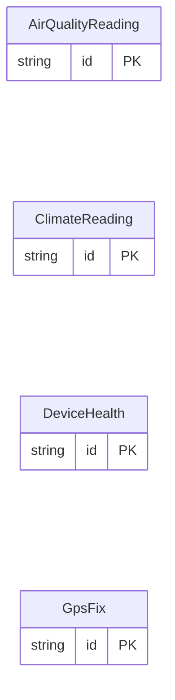

<!-- Code generated by protoc-gen-store. DO NOT EDIT. -->

# `sensors_db` — GORM models

Go structs with GORM struct tags — one package per schema.

Generated from Protobuf by protoc-gen-store. Source of truth is the `.proto` files — regenerate rather than editing.

| Models | Enums |
| ---: | ---: |
| 4 | 1 |

## Entity relationships

## Output

- `<schema>/models.go` — one Go package per schema, one struct per table.
- `migrate.go` — a factory `Registry` (with a preloaded `Default`) that migrates every model in one call; emitted when the `go_module` opt is set. Call `Default.EnsureSchemas(db)` before `Default.Migrate(db)` so the schema-qualified tables have their Postgres schemas.
- Nullable columns are pointer types; proto enums become string-typed Go enums.
- Attach in main: `Default.EnsureSchemas(db)` then `Default.Migrate(db)`, or wire the structs into a `*gorm.DB` and run AutoMigrate yourself.
- `<schema>/<model>_store.go` — a typed CRUD store per resource (Create, GetByID, List, Count, Update, DeleteByID, plus GetBy/ListBy finders for unique and foreign-key columns); emitted when the `stores` opt is set (which also requires `go_module`). Requires `gorm.io/gorm`.
- `gormx/gormx.go` — the shared runtime every store imports: `ListOptions`, the generic `Store[M]` interface every store satisfies, a `GenericStore[M]` engine that runs CRUD for any model with no per-entity code, and `EnsureSchemas`. Lets one generic engine drive every entity.
- `telemetry/telemetry.go` — the first-party telemetry adapter: `New(o)` wraps an SDK handle as the `gormx.Telemetry` the stores observe through (`WithTelemetry(telemetry.New(o))`), and `Plugin(o)` is the SQL-level gorm plugin. Emitted with the `telemetry` opt; requires `github.com/the-protobuf-project/telemetry/telemetry-go`.
- `Registry.Instrument(db, o)` in `migrate.go` — installs the generated telemetry gorm plugin so every query emits a span (and metric) through the SDK handle.

## Schema `fleet`

### `DeviceHealth` → `device_healths`

DeviceHealth is a sensor's periodic self-report.

| Column | Type | Null |
| --- | --- | --- |
| `id` | `CHAR(26)` | not null |
| `device_id` | `VARCHAR(255)` | nullable |
| `firmware` | `VARCHAR(255)` | nullable |
| `report_time` | `TIMESTAMPTZ` | nullable |
| `battery_pct` | `REAL` | nullable |
| `rssi_dbm` | `INTEGER` | nullable |
| `uptime_s` | `NUMERIC(20,0)` | nullable |
| `charging` | `BOOLEAN` | nullable |

### `GpsFix` → `gps_fixes`

GpsFix is a sensor's position fix.

| Column | Type | Null |
| --- | --- | --- |
| `id` | `CHAR(26)` | not null |
| `device_id` | `VARCHAR(255)` | nullable |
| `fix_time` | `TIMESTAMPTZ` | nullable |
| `latitude` | `DOUBLE PRECISION` | nullable |
| `longitude` | `DOUBLE PRECISION` | nullable |
| `altitude_m` | `REAL` | nullable |
| `satellites` | `BIGINT` | nullable |

## Schema `environment`

### `ClimateReading` → `climate_readings`

ClimateReading is one sample of a climate sensor.

| Column | Type | Null |
| --- | --- | --- |
| `id` | `CHAR(26)` | not null |
| `device_id` | `VARCHAR(255)` | nullable |
| `site` | `VARCHAR(255)` | nullable |
| `observe_time` | `TIMESTAMPTZ` | nullable |
| `temperature_c` | `DOUBLE PRECISION` | nullable |
| `humidity_pct` | `DOUBLE PRECISION` | nullable |
| `pressure_hpa` | `REAL` | nullable |
| `co2_ppm` | `BIGINT` | nullable |
| `quality` | `ReadingQuality` | nullable |

### `AirQualityReading` → `air_quality_readings`

AirQualityReading is one sample of a particulate sensor.

| Column | Type | Null |
| --- | --- | --- |
| `id` | `CHAR(26)` | not null |
| `device_id` | `VARCHAR(255)` | nullable |
| `site` | `VARCHAR(255)` | nullable |
| `observe_time` | `TIMESTAMPTZ` | nullable |
| `pm2_5` | `DOUBLE PRECISION` | nullable |
| `pm10` | `DOUBLE PRECISION` | nullable |
| `voc_index` | `INTEGER` | nullable |

### Enums

- `ReadingQuality`: GOOD, STALE_CALIBRATION, OUT_OF_RANGE
