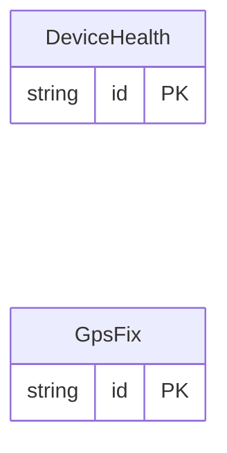

<!-- Code generated by protoc-gen-store. DO NOT EDIT. -->

# `sensors_db/device/` — Prisma schema

Generated from Protobuf by protoc-gen-store. Source of truth is the `.proto` files — regenerate rather than editing.

| Models | Enums |
| ---: | ---: |
| 2 | 0 |

## Entity relationships

Schema file: [`device.postgres.prisma`](./device.postgres.prisma)

### `DeviceHealth` → `device_healths`

DeviceHealth is a sensor's periodic self-report.

| Column | Type | Null |
| --- | --- | --- |
| `id` | `CHAR(26)` | not null |
| `device_id` | `VARCHAR(255)` | nullable |
| `firmware` | `VARCHAR(255)` | nullable |
| `report_time` | `TIMESTAMPTZ` | nullable |
| `battery_pct` | `REAL` | nullable |
| `rssi_dbm` | `INTEGER` | nullable |
| `uptime_s` | `NUMERIC(20,0)` | nullable |
| `charging` | `BOOLEAN` | nullable |

### `GpsFix` → `gps_fixes`

GpsFix is a sensor's position fix.

| Column | Type | Null |
| --- | --- | --- |
| `id` | `CHAR(26)` | not null |
| `device_id` | `VARCHAR(255)` | nullable |
| `fix_time` | `TIMESTAMPTZ` | nullable |
| `latitude` | `DOUBLE PRECISION` | nullable |
| `longitude` | `DOUBLE PRECISION` | nullable |
| `altitude_m` | `REAL` | nullable |
| `satellites` | `BIGINT` | nullable |
