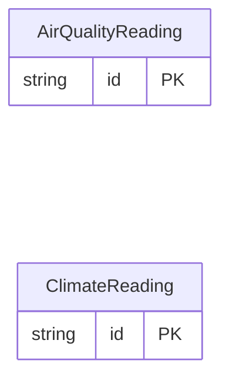

<!-- Code generated by protoc-gen-store. DO NOT EDIT. -->

# `sensors_db/environment/` — Prisma schema

Generated from Protobuf by protoc-gen-store. Source of truth is the `.proto` files — regenerate rather than editing.

| Models | Enums |
| ---: | ---: |
| 2 | 1 |

## Entity relationships

Schema file: [`environment.postgres.prisma`](./environment.postgres.prisma)

### `ClimateReading` → `climate_readings`

ClimateReading is one sample of a climate sensor.

| Column | Type | Null |
| --- | --- | --- |
| `id` | `CHAR(26)` | not null |
| `device_id` | `VARCHAR(255)` | nullable |
| `site` | `VARCHAR(255)` | nullable |
| `observe_time` | `TIMESTAMPTZ` | nullable |
| `temperature_c` | `DOUBLE PRECISION` | nullable |
| `humidity_pct` | `DOUBLE PRECISION` | nullable |
| `pressure_hpa` | `REAL` | nullable |
| `co2_ppm` | `BIGINT` | nullable |
| `quality` | `ReadingQuality` | nullable |

### `AirQualityReading` → `air_quality_readings`

AirQualityReading is one sample of a particulate sensor.

| Column | Type | Null |
| --- | --- | --- |
| `id` | `CHAR(26)` | not null |
| `device_id` | `VARCHAR(255)` | nullable |
| `site` | `VARCHAR(255)` | nullable |
| `observe_time` | `TIMESTAMPTZ` | nullable |
| `pm2_5` | `DOUBLE PRECISION` | nullable |
| `pm10` | `DOUBLE PRECISION` | nullable |
| `voc_index` | `INTEGER` | nullable |

### Enums

- `ReadingQuality`: GOOD, STALE_CALIBRATION, OUT_OF_RANGE
