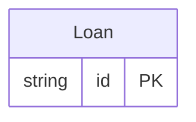

<!-- Code generated by protoc-gen-store. DO NOT EDIT. -->

# `lending` — PostgreSQL schema

CREATE SCHEMA / TYPE / TABLE DDL with foreign keys and indexes.

Generated from Protobuf by protoc-gen-store. Source of truth is the `.proto` files — regenerate rather than editing.

| Models | Enums |
| ---: | ---: |
| 1 | 0 |

## Entity relationships

## Output

- `migrate.sql` — the whole database in one transactional file; apply with `psql -f migrate.sql`.
- `<schema>.postgres.sql` — one DDL file per schema (apply referenced tables before referencing ones).
- Auto-update triggers keep updated-at columns current; COMMENT ON persists field docs to the catalog.
- Foreign keys into another database on the same server are added NOT VALID at the end of `migrate.sql`, when missing and once their target table exists; `validate.sql` validates them when the rows that predate them are clean.

## Schema `lending`

### `Loan` → `loans`

A loan of a book to a borrower.

| Column | Type | Null |
| --- | --- | --- |
| `id` | `CHAR(26)` | not null |
| `name` | `VARCHAR(255)` | not null |
| `book` | `VARCHAR(255)` | not null |
| `borrower` | `VARCHAR(255)` | not null |
| `guarantor` | `VARCHAR(255)` | nullable |
| `state` | `VARCHAR(255)` | nullable |
| `etag` | `VARCHAR(255)` | nullable |
| `delete_time` | `TIMESTAMPTZ` | nullable |
| `expire_time` | `TIMESTAMPTZ` | nullable |
