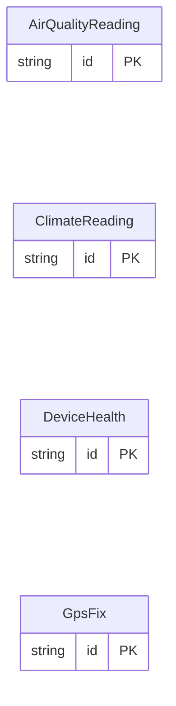

<!-- Code generated by protoc-gen-store. DO NOT EDIT. -->

# `sensors_db` — PostgreSQL schema

CREATE SCHEMA / TYPE / TABLE DDL with foreign keys and indexes.

Generated from Protobuf by protoc-gen-store. Source of truth is the `.proto` files — regenerate rather than editing.

| Models | Enums |
| ---: | ---: |
| 4 | 1 |

## Entity relationships

## Output

- `migrate.sql` — the whole database in one transactional file; apply with `psql -f migrate.sql`.
- `<schema>.postgres.sql` — one DDL file per schema (apply referenced tables before referencing ones).
- Auto-update triggers keep updated-at columns current; COMMENT ON persists field docs to the catalog.

## Schema `fleet`

### `DeviceHealth` → `device_healths`

DeviceHealth is a sensor's periodic self-report.

| Column | Type | Null |
| --- | --- | --- |
| `id` | `CHAR(26)` | not null |
| `device_id` | `VARCHAR(255)` | nullable |
| `firmware` | `VARCHAR(255)` | nullable |
| `report_time` | `TIMESTAMPTZ` | nullable |
| `battery_pct` | `REAL` | nullable |
| `rssi_dbm` | `INTEGER` | nullable |
| `uptime_s` | `NUMERIC(20,0)` | nullable |
| `charging` | `BOOLEAN` | nullable |

### `GpsFix` → `gps_fixes`

GpsFix is a sensor's position fix.

| Column | Type | Null |
| --- | --- | --- |
| `id` | `CHAR(26)` | not null |
| `device_id` | `VARCHAR(255)` | nullable |
| `fix_time` | `TIMESTAMPTZ` | nullable |
| `latitude` | `DOUBLE PRECISION` | nullable |
| `longitude` | `DOUBLE PRECISION` | nullable |
| `altitude_m` | `REAL` | nullable |
| `satellites` | `BIGINT` | nullable |

## Schema `environment`

### `ClimateReading` → `climate_readings`

ClimateReading is one sample of a climate sensor.

| Column | Type | Null |
| --- | --- | --- |
| `id` | `CHAR(26)` | not null |
| `device_id` | `VARCHAR(255)` | nullable |
| `site` | `VARCHAR(255)` | nullable |
| `observe_time` | `TIMESTAMPTZ` | nullable |
| `temperature_c` | `DOUBLE PRECISION` | nullable |
| `humidity_pct` | `DOUBLE PRECISION` | nullable |
| `pressure_hpa` | `REAL` | nullable |
| `co2_ppm` | `BIGINT` | nullable |
| `quality` | `ReadingQuality` | nullable |

### `AirQualityReading` → `air_quality_readings`

AirQualityReading is one sample of a particulate sensor.

| Column | Type | Null |
| --- | --- | --- |
| `id` | `CHAR(26)` | not null |
| `device_id` | `VARCHAR(255)` | nullable |
| `site` | `VARCHAR(255)` | nullable |
| `observe_time` | `TIMESTAMPTZ` | nullable |
| `pm2_5` | `DOUBLE PRECISION` | nullable |
| `pm10` | `DOUBLE PRECISION` | nullable |
| `voc_index` | `INTEGER` | nullable |

### Enums

- `ReadingQuality`: GOOD, STALE_CALIBRATION, OUT_OF_RANGE
