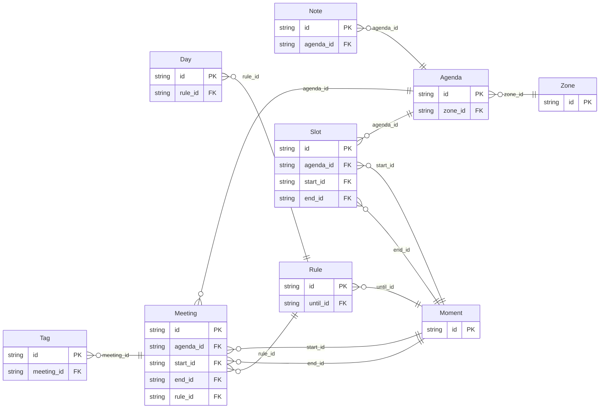

<!-- Code generated by protoc-gen-store. DO NOT EDIT. -->

# `v1` — GORM models

Go structs with GORM struct tags — one package per schema.

Generated from Protobuf by protoc-gen-store. Source of truth is the `.proto` files — regenerate rather than editing.

| Models | Enums |
| ---: | ---: |
| 9 | 2 |

## Entity relationships

## Output

- `<schema>/models.go` — one Go package per schema, one struct per table.
- `migrate.go` — a factory `Registry` (with a preloaded `Default`) that migrates every model in one call; emitted when the `go_module` opt is set. Call `Default.EnsureSchemas(db)` before `Default.Migrate(db)` so the schema-qualified tables have their Postgres schemas.
- Nullable columns are pointer types; proto enums become string-typed Go enums.
- Attach in main: `Default.EnsureSchemas(db)` then `Default.Migrate(db)`, or wire the structs into a `*gorm.DB` and run AutoMigrate yourself.

## Schema `deep_v1`

### `Agenda` → `agendas`

Agenda exercises a natural-key value object and has-many children with nested value objects.

| Column | Type | Null |
| --- | --- | --- |
| `id` | `CHAR(26)` | not null |
| `name` | `VARCHAR(255)` | not null |
| `etag` | `VARCHAR(255)` | nullable |
| `delete_time` | `TIMESTAMPTZ` | nullable |
| `zone_id` | `VARCHAR(255)` | nullable |

### `Meeting` → `meetings`

Meeting exercises deep singular graphs, a oneof deep edge and an ambiguous pair of lists.

| Column | Type | Null |
| --- | --- | --- |
| `id` | `CHAR(26)` | not null |
| `name` | `VARCHAR(255)` | not null |
| `duration` | `INTERVAL` | nullable |
| `etag` | `VARCHAR(255)` | nullable |
| `ends_case` | `MeetingEndsCase` | nullable |
| `agenda_id` | `CHAR(26)` | not null |
| `start_id` | `CHAR(26)` | not null |
| `end_id` | `CHAR(26)` | nullable |
| `rule_id` | `CHAR(26)` | nullable |

### `Zone` → `zones`

Zone is keyed by its own field, not a minted id: a natural-key value object, shared by every agenda in the zone (upserted, never deleted with an owner).

| Column | Type | Null |
| --- | --- | --- |
| `id` | `VARCHAR(255)` | not null |
| `version` | `VARCHAR(255)` | nullable |

### `Slot` → `slots`

Slot is a has-many child carrying singular value objects of its own.

| Column | Type | Null |
| --- | --- | --- |
| `id` | `CHAR(26)` | not null |
| `rule` | `VARCHAR(255)` | nullable |
| `agenda_id` | `CHAR(26)` | not null |
| `start_id` | `CHAR(26)` | not null |
| `end_id` | `CHAR(26)` | nullable |

### `Note` → `notes`

Note is a plain has-many child.

| Column | Type | Null |
| --- | --- | --- |
| `id` | `CHAR(26)` | not null |
| `text` | `VARCHAR(255)` | not null |
| `weight` | `DOUBLE PRECISION` | nullable |
| `agenda_id` | `CHAR(26)` | not null |

### `Moment` → `moments`

Moment is a keyed value object used singly at several depths.

| Column | Type | Null |
| --- | --- | --- |
| `id` | `CHAR(26)` | not null |
| `at` | `TIMESTAMPTZ` | not null |

### `Rule` → `rules`

Rule is a singular value object with a has-many child and a oneof member value object of its own.

| Column | Type | Null |
| --- | --- | --- |
| `id` | `CHAR(26)` | not null |
| `frequency` | `VARCHAR(255)` | not null |
| `count` | `INTEGER` | nullable |
| `bound_case` | `RuleBoundCase` | nullable |
| `until_id` | `CHAR(26)` | nullable |

### `Tag` → `tags`

Tag is held in two lists by one message: ambiguous, so never generated.

| Column | Type | Null |
| --- | --- | --- |
| `id` | `CHAR(26)` | not null |
| `label` | `VARCHAR(255)` | not null |
| `meeting_id` | `CHAR(26)` | not null |

### `Day` → `days`

Day is a has-many child two levels down.

| Column | Type | Null |
| --- | --- | --- |
| `id` | `CHAR(26)` | not null |
| `code` | `VARCHAR(255)` | not null |
| `rule_id` | `CHAR(26)` | not null |

### Enums

- `MeetingEndsCase`: END, DURATION
- `RuleBoundCase`: UNTIL, COUNT
