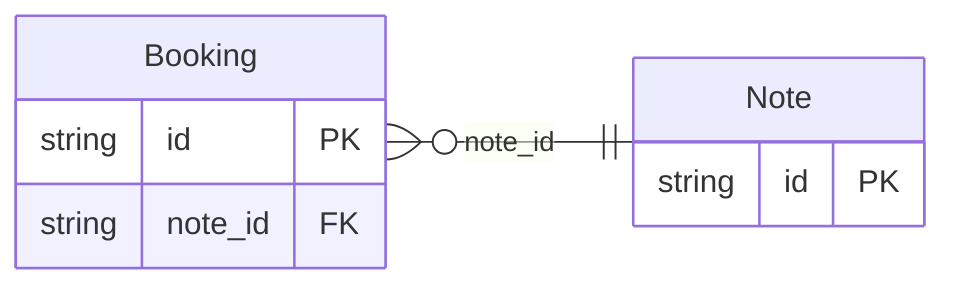

<!-- Code generated by protoc-gen-store. DO NOT EDIT. -->

# `v1` — PostgreSQL schema

CREATE SCHEMA / TYPE / TABLE DDL with foreign keys and indexes.

Generated from Protobuf by protoc-gen-store. Source of truth is the `.proto` files — regenerate rather than editing.

| Models | Enums |
| ---: | ---: |
| 2 | 1 |

## Entity relationships

## Output

- `migrate.sql` — the whole database in one transactional file; apply with `psql -f migrate.sql`.
- `<schema>.postgres.sql` — one DDL file per schema (apply referenced tables before referencing ones).
- Auto-update triggers keep updated-at columns current; COMMENT ON persists field docs to the catalog.

## Schema `stay_v1`

### `Booking` → `bookings`

A booking, written in an imported vocabulary.

| Column | Type | Null |
| --- | --- | --- |
| `id` | `CHAR(26)` | not null |
| `name` | `VARCHAR(255)` | not null |
| `state` | `VARCHAR(255)` | nullable |
| `stay` | `JSONB` | nullable |
| `guests` | `JSONB` | nullable |
| `address` | `JSONB` | not null |
| `exchange_rate` | `NUMERIC` | nullable |
| `percent` | `NUMERIC` | nullable |
| `amount` | `BIGINT` | nullable |
| `adjustment_case` | `BookingAdjustmentCase` | nullable |
| `note_id` | `CHAR(26)` | nullable |

### `Note` → `notes`

A note of the booking's own package.

| Column | Type | Null |
| --- | --- | --- |
| `id` | `CHAR(26)` | not null |
| `text` | `VARCHAR(255)` | nullable |

### Enums

- `BookingAdjustmentCase`: PERCENT, AMOUNT
