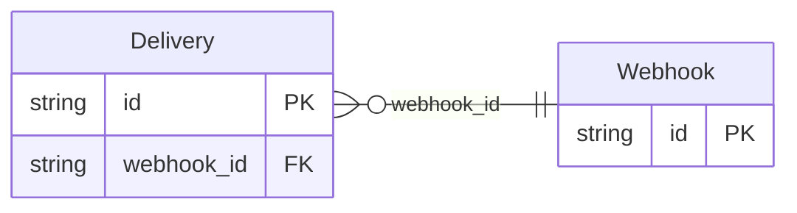

<!-- Code generated by protoc-gen-store. DO NOT EDIT. -->

# `v1` — PostgreSQL schema

CREATE SCHEMA / TYPE / TABLE DDL with foreign keys and indexes.

Generated from Protobuf by protoc-gen-store. Source of truth is the `.proto` files — regenerate rather than editing.

| Models | Enums |
| ---: | ---: |
| 2 | 2 |

## Entity relationships

## Output

- `migrate.sql` — the whole database in one transactional file; apply with `psql -f migrate.sql`.
- `<schema>.postgres.sql` — one DDL file per schema (apply referenced tables before referencing ones).
- Auto-update triggers keep updated-at columns current; COMMENT ON persists field docs to the catalog.

## Schema `hooks_v1`

### `Webhook` → `webhooks`

A webhook subscription. Its nested State shares the simple name "State" with Delivery.State in the one schema both land in, so every target names them apart by their enclosing message: WebhookState / webhook_state and DeliveryState / delivery_state. Their values keep the proto's own "STATE_" prefix stripped, and the filters and the GraphQL converters strip "STATE_", not "WEBHOOK_STATE_".

| Column | Type | Null |
| --- | --- | --- |
| `id` | `CHAR(26)` | not null |
| `name` | `VARCHAR(255)` | not null |
| `uri` | `VARCHAR(255)` | not null |
| `state` | `WebhookState` | not null |
| `etag` | `VARCHAR(255)` | nullable |
| `create_time` | `TIMESTAMPTZ` | not null |

### `Delivery` → `deliveries`

One delivery attempt of a webhook, with a State of its own.

| Column | Type | Null |
| --- | --- | --- |
| `id` | `CHAR(26)` | not null |
| `name` | `VARCHAR(255)` | not null |
| `state` | `DeliveryState` | nullable |
| `webhook_state` | `WebhookState` | nullable |
| `etag` | `VARCHAR(255)` | nullable |
| `create_time` | `TIMESTAMPTZ` | not null |
| `webhook_id` | `CHAR(26)` | not null |

### Enums

- `WebhookState`: ACTIVE, PAUSED
- `DeliveryState`: PENDING, SUCCEEDED, FAILED
