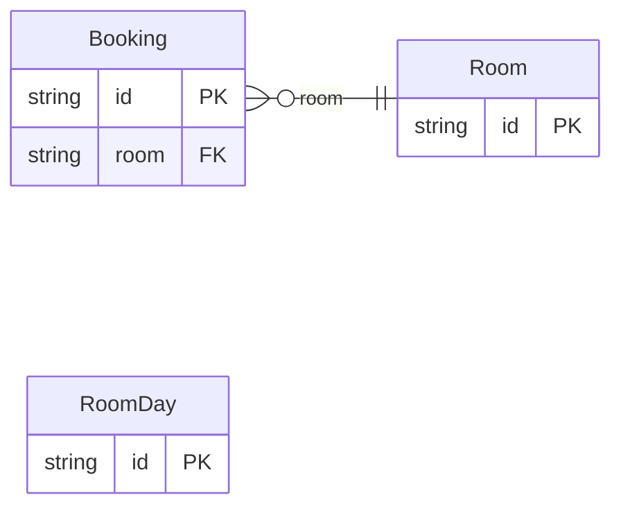

<!-- Code generated by protoc-gen-store. DO NOT EDIT. -->

# `v1/projection/` — Prisma schema

Generated from Protobuf by protoc-gen-store. Source of truth is the `.proto` files — regenerate rather than editing.

| Models | Enums |
| ---: | ---: |
| 3 | 0 |

## Entity relationships

Schema file: [`projection.postgres.prisma`](./projection.postgres.prisma)

### `Room` → `rooms`

A room that can be booked.

| Column | Type | Null |
| --- | --- | --- |
| `id` | `CHAR(26)` | not null |
| `name` | `VARCHAR(255)` | not null |
| `display_name` | `VARCHAR(255)` | not null |
| `kinds` | `VARCHAR(255)[]` | nullable |
| `floor` | `INTEGER` | nullable |
| `attributes` | `JSONB` | nullable |

### `Booking` → `bookings`

A booking of a room for a time.

| Column | Type | Null |
| --- | --- | --- |
| `id` | `CHAR(26)` | not null |
| `name` | `VARCHAR(255)` | not null |
| `room` | `CHAR(26)` | not null |
| `start_time` | `TIMESTAMPTZ` | not null |
| `end_time` | `TIMESTAMPTZ` | not null |

### `RoomDay` → `room_days`

RoomDay is one room's free time on one day: the projection a search by time window reads instead of the bookings.

| Column | Type | Null |
| --- | --- | --- |
| `id` | `TEXT` | not null |
| `room` | `TEXT` | not null |
| `day` | `DATE` | not null |
| `free` | `TSTZMULTIRANGE` | not null |
| `kinds` | `TEXT[]` | not null |
| `floor` | `INTEGER` | not null |
| `attributes` | `JSONB` | not null |
| `occupancy` | `VARCHAR(255)` | not null |
| `display_name` | `TEXT` | not null |
| `row_version` | `BIGINT` | not null |
