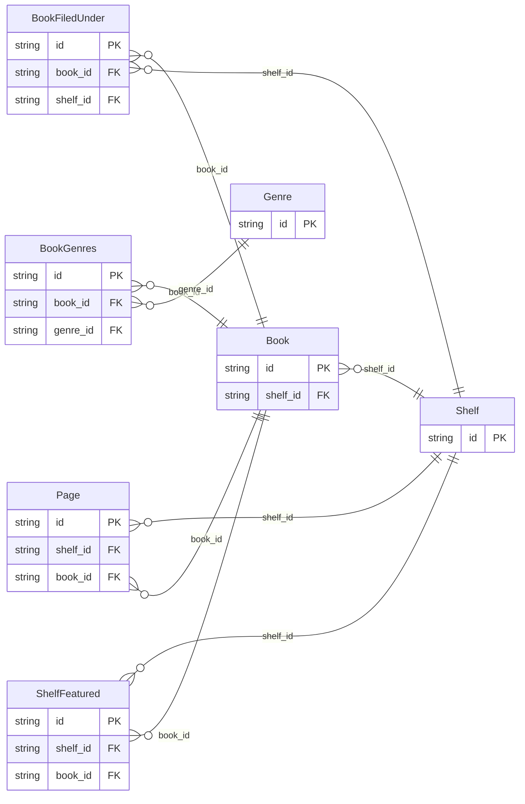

<!-- Code generated by protoc-gen-store. DO NOT EDIT. -->

# `catalog/a_catalog/` — Prisma schema

Generated from Protobuf by protoc-gen-store. Source of truth is the `.proto` files — regenerate rather than editing.

| Models | Enums |
| ---: | ---: |
| 7 | 0 |

## Entity relationships

Schema file: [`a_catalog.postgres.prisma`](./a_catalog.postgres.prisma)

### `Shelf` → `shelves`

A shelf holds books.

| Column | Type | Null |
| --- | --- | --- |
| `id` | `CHAR(26)` | not null |
| `name` | `VARCHAR(255)` | not null |
| `display_name` | `VARCHAR(255)` | not null |
| `etag` | `VARCHAR(255)` | nullable |
| `delete_time` | `TIMESTAMPTZ` | nullable |
| `expire_time` | `TIMESTAMPTZ` | nullable |

### `Book` → `books`

A book on a shelf: a nested resource, so a reference to it stores its full name and a foreign key to it targets its name column.

| Column | Type | Null |
| --- | --- | --- |
| `id` | `CHAR(26)` | not null |
| `name` | `VARCHAR(255)` | not null |
| `title` | `VARCHAR(255)` | not null |
| `etag` | `VARCHAR(255)` | nullable |
| `delete_time` | `TIMESTAMPTZ` | nullable |
| `expire_time` | `TIMESTAMPTZ` | nullable |
| `shelf_id` | `CHAR(26)` | not null |

### `Genre` → `genres`

A genre books are classed under: deleted outright, with no soft delete.

| Column | Type | Null |
| --- | --- | --- |
| `id` | `CHAR(26)` | not null |
| `name` | `VARCHAR(255)` | not null |
| `display_name` | `VARCHAR(255)` | not null |

### `Page` → `pages`

A page of a book: nested two deep, so the row it hangs off is a nested resource's, found by its name.

| Column | Type | Null |
| --- | --- | --- |
| `id` | `CHAR(26)` | not null |
| `name` | `VARCHAR(255)` | not null |
| `text` | `VARCHAR(255)` | nullable |
| `shelf_id` | `CHAR(26)` | not null |
| `book_id` | `CHAR(26)` | not null |

### `ShelfFeatured` → `shelf_featured`

Join table for the many-to-many relation Shelf.featured ↔ Book.

| Column | Type | Null |
| --- | --- | --- |
| `id` | `CHAR(26)` | not null |
| `shelf_id` | `CHAR(26)` | not null |
| `book_id` | `CHAR(26)` | not null |
| `book_name` | `TEXT` | not null |

### `BookFiledUnder` → `book_filed_under`

Join table for the many-to-many relation Book.filed_under ↔ Shelf.

| Column | Type | Null |
| --- | --- | --- |
| `id` | `CHAR(26)` | not null |
| `book_id` | `CHAR(26)` | not null |
| `shelf_id` | `CHAR(26)` | not null |

### `BookGenres` → `book_genres`

Join table for the many-to-many relation Book.genres ↔ Genre.

| Column | Type | Null |
| --- | --- | --- |
| `id` | `CHAR(26)` | not null |
| `book_id` | `CHAR(26)` | not null |
| `genre_id` | `CHAR(26)` | not null |
