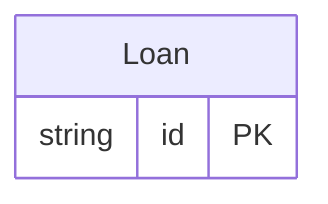

<!-- Code generated by protoc-gen-store. DO NOT EDIT. -->

# `lending/b_lending/` — Prisma schema

Generated from Protobuf by protoc-gen-store. Source of truth is the `.proto` files — regenerate rather than editing.

| Models | Enums |
| ---: | ---: |
| 1 | 0 |

## Entity relationships

Schema file: [`b_lending.postgres.prisma`](./b_lending.postgres.prisma)

### `Loan` → `loans`

A loan of a book to a borrower.

| Column | Type | Null |
| --- | --- | --- |
| `id` | `CHAR(26)` | not null |
| `name` | `VARCHAR(255)` | not null |
| `book` | `VARCHAR(255)` | not null |
| `borrower` | `VARCHAR(255)` | not null |
| `guarantor` | `VARCHAR(255)` | nullable |
| `state` | `VARCHAR(255)` | nullable |
| `etag` | `VARCHAR(255)` | nullable |
| `delete_time` | `TIMESTAMPTZ` | nullable |
| `expire_time` | `TIMESTAMPTZ` | nullable |
