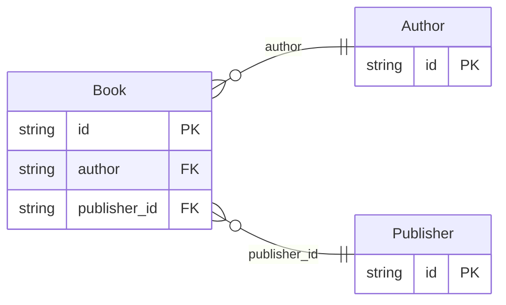

<!-- Code generated by protoc-gen-store. DO NOT EDIT. -->

# `library_db` — GORM models

Go structs with GORM struct tags — one package per schema.

Generated from Protobuf by protoc-gen-store. Source of truth is the `.proto` files — regenerate rather than editing.

| Models | Enums |
| ---: | ---: |
| 3 | 1 |

## Entity relationships

## Output

- `<schema>/models.go` — one Go package per schema, one struct per table.
- `migrate.go` — a factory `Registry` (with a preloaded `Default`) that migrates every model in one call; emitted when the `go_module` opt is set. Call `Default.EnsureSchemas(db)` before `Default.Migrate(db)` so the schema-qualified tables have their Postgres schemas.
- Nullable columns are pointer types; proto enums become string-typed Go enums.
- Attach in main: `Default.EnsureSchemas(db)` then `Default.Migrate(db)`, or wire the structs into a `*gorm.DB` and run AutoMigrate yourself.

## Schema `library_v1`

### `Publisher` → `publishers`

Publisher is a root resource with every AIP rule the runtime applies: an etag, soft delete (delete_time, expire_time) and audit times.

| Column | Type | Null |
| --- | --- | --- |
| `id` | `CHAR(26)` | not null |
| `name` | `VARCHAR(255)` | not null |
| `display_name` | `VARCHAR(255)` | not null |
| `slug` | `VARCHAR(255)` | nullable |
| `etag` | `VARCHAR(255)` | nullable |
| `create_time` | `TIMESTAMPTZ` | not null |
| `update_time` | `TIMESTAMPTZ` | not null |
| `delete_time` | `TIMESTAMPTZ` | nullable |
| `expire_time` | `TIMESTAMPTZ` | nullable |

### `Author` → `authors`

Author is a root resource whose audit times the table synthesizes (timestamps: true adds created_at and updated_at, which no field carries).

| Column | Type | Null |
| --- | --- | --- |
| `id` | `CHAR(26)` | not null |
| `name` | `VARCHAR(255)` | not null |
| `display_name` | `VARCHAR(255)` | not null |
| `bio` | `TEXT` | nullable |
| `created_at` | `TIMESTAMPTZ` | not null |
| `updated_at` | `TIMESTAMPTZ` | not null |

### `Book` → `books`

Book is nested under a publisher and references its author: a parent foreign key, a reference foreign key, and a column of every scalar kind.

| Column | Type | Null |
| --- | --- | --- |
| `id` | `CHAR(26)` | not null |
| `name` | `VARCHAR(255)` | not null |
| `title` | `VARCHAR(500)` | not null |
| `author` | `CHAR(26)` | nullable |
| `format` | `Format` | not null |
| `pages` | `INTEGER` | nullable |
| `copies_sold` | `NUMERIC(20,0)` | nullable |
| `price` | `DOUBLE PRECISION` | nullable |
| `in_print` | `BOOLEAN` | nullable |
| `cover_digest` | `BYTEA` | nullable |
| `publish_time` | `TIMESTAMPTZ` | nullable |
| `etag` | `VARCHAR(255)` | nullable |
| `create_time` | `TIMESTAMPTZ` | not null |
| `publisher_id` | `CHAR(26)` | not null |

### Enums

- `Format`: HARDCOVER, PAPERBACK, EBOOK
