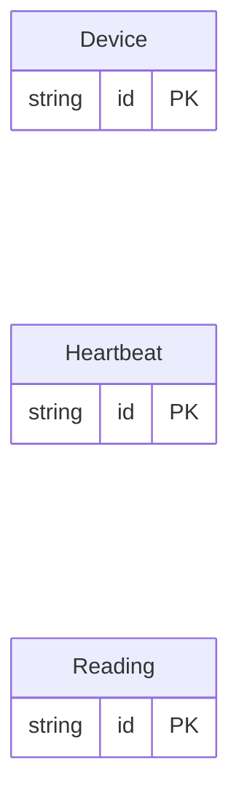

<!-- Code generated by protoc-gen-store. DO NOT EDIT. -->

# `telemetry_db` — PostgreSQL schema

CREATE SCHEMA / TYPE / TABLE DDL with foreign keys and indexes.

Generated from Protobuf by protoc-gen-store. Source of truth is the `.proto` files — regenerate rather than editing.

| Models | Enums |
| ---: | ---: |
| 3 | 1 |

## Entity relationships

## Output

- `migrate.sql` — the whole database in one transactional file; apply with `psql -f migrate.sql`.
- `<schema>.postgres.sql` — one DDL file per schema (apply referenced tables before referencing ones).
- Auto-update triggers keep updated-at columns current; COMMENT ON persists field docs to the catalog.

## Schema `telemetry`

### `Reading` → `readings`

Reading is one sensor sample.

| Column | Type | Null |
| --- | --- | --- |
| `id` | `CHAR(26)` | not null |
| `device` | `VARCHAR(255)` | not null |
| `site` | `VARCHAR(255)` | not null |
| `observe_time` | `TIMESTAMPTZ` | not null |
| `value` | `DOUBLE PRECISION` | nullable |
| `raw` | `REAL` | nullable |
| `quality` | `Quality` | nullable |
| `samples` | `INTEGER` | nullable |
| `sequence` | `NUMERIC(20,0)` | nullable |
| `fault` | `BOOLEAN` | nullable |
| `type` | `VARCHAR(255)` | nullable |
| `calibrate_time` | `TIMESTAMPTZ` | nullable |

### `Heartbeat` → `heartbeats`

Heartbeat is a liveness ping keyed by nothing but time.

| Column | Type | Null |
| --- | --- | --- |
| `id` | `CHAR(26)` | not null |
| `at_nanos` | `BIGINT` | nullable |
| `uptime` | `BIGINT` | nullable |

### `Device` → `devices`

Device is relational: it declares no time series.

| Column | Type | Null |
| --- | --- | --- |
| `id` | `CHAR(26)` | not null |
| `name` | `VARCHAR(255)` | not null |
| `label` | `VARCHAR(255)` | nullable |

### Enums

- `Quality`: GOOD, SUSPECT
